<div align="center">


# 차곡차곡

**차와 함께한 시간을 차곡차곡, 매일의 운전을 카드 수집과 성장의 즐거움으로 바꾸는 서비스**

[제출용 APK 다운로드](apk/가차_차곡차곡_release.apk?raw=true) · [주요 기능](#features) · [시연 영상](#demo) · [차량에서의 사용](#in-car-experience) · [아키텍처와 구현](#engineering) · [빌드 및 실행](#build--run)

</div>

<table>
  <tr><th width="50%">홈 · 오늘의 추천 장소와 대표 카드</th><th width="50%">컬렉션 · 내가 모은 카드</th></tr>
  <tr>
    <td align="center">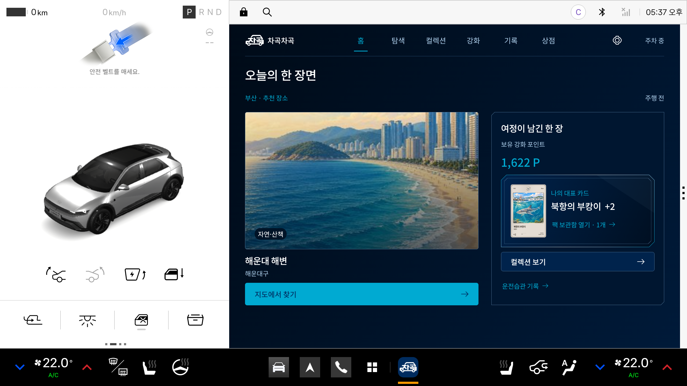</td>
    <td align="center">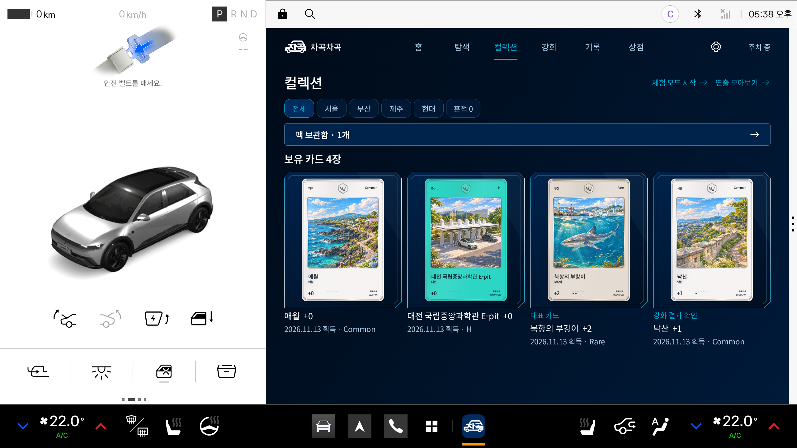</td>
  </tr>
</table>

## Overview

어디를 다녀왔는지는 기억해도, 그곳까지 달린 시간은 쉽게 잊힙니다. **차곡차곡**은 긴 운전 끝에 기다릴 작은 즐거움을 만듭니다. 평소처럼 달린 날에는 강화 포인트가, 새로운 장소를 찾아간 날에는 그 지역의 카드팩이 남습니다. 차를 세우고 봉투를 열면, 다음 주행에서 키우고 싶은 카드가 생깁니다.

<a id="features"></a>

## Features

### 01 — 주행과 방문 보상

탐색에서 등록한 목적지와 경유지는 차량의 기본 내비게이션에 표시됩니다. 등록한 장소에 도착해 P단에 주차하면 해당 지역의 방문팩을 받을 수 있습니다. 주행을 마치면 달린 거리와 안전점수에 따라 포인트가 쌓입니다. 장소를 방문하지 않은 일상 주행도 적립 대상입니다.

<table>
  <tr><th width="50%">첫 주행과 서울 방문팩</th><th width="50%">경유지 등록과 PLUS 적립</th></tr>
  <tr>
    <td align="center">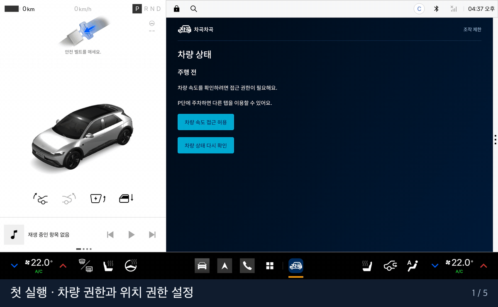</td>
    <td align="center">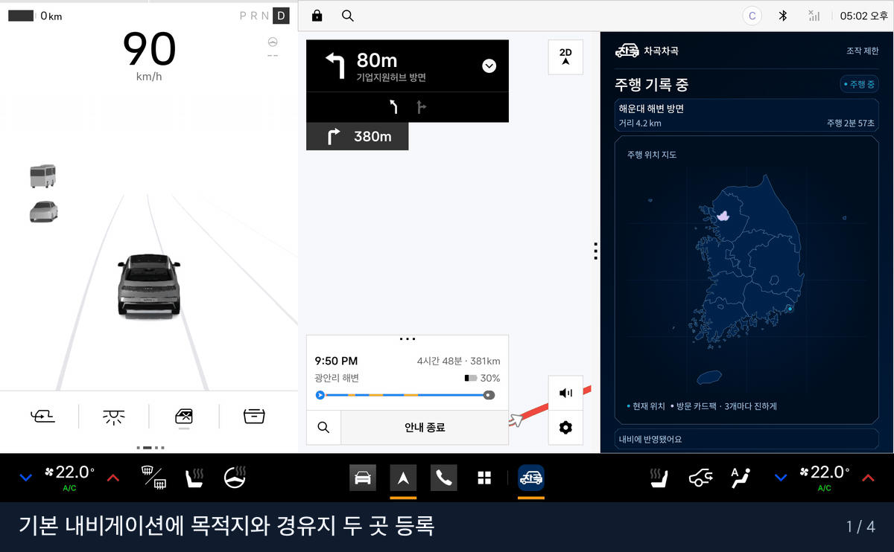</td>
  </tr>
</table>

### 02 — 카드팩 개봉과 컬렉션

서울·부산·제주·현대, 네 종류의 팩에 **45종의 기본 도안**이 있습니다. 처음에는 서울 선물팩 하나와 1,000P로 시작합니다. 팩 보관함에서 봉투를 뜯고 카드를 뒤집어 그림과 등급을 확인합니다. 방문 지도에는 팩을 받은 지역이 칠해집니다.

<table>
  <tr><th width="50%">부산 팩 개봉 · 북항의 부캉이</th><th width="50%">등급별 카드 공개</th></tr>
  <tr>
    <td align="center"></td>
    <td align="center"></td>
  </tr>
</table>

### 03 — 카드 강화

컬렉션에서 마음에 드는 카드를 골라 주행 포인트를 씁니다. **+5·+10·+15·+20·+25**마다 프레임과 재질이 바뀌고, **+15부터는 원화가 카드 전체를 덮습니다.** 카드를 기울이면 포일과 프리즘의 반사광도 각도에 따라 움직입니다.

<table>
  <tr><th width="50%">부캉이 강화 · +0 → +2</th><th width="50%">재실행 후 대표 카드와 기록</th></tr>
  <tr>
    <td align="center">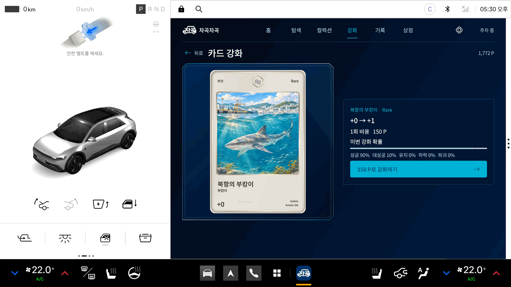</td>
    <td align="center">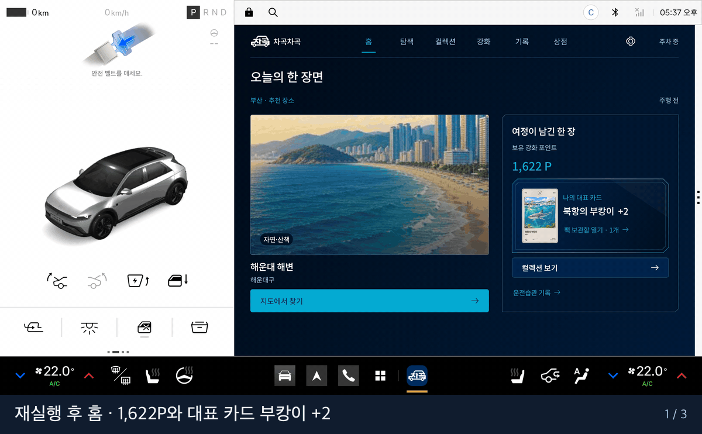</td>
  </tr>
</table>

<a id="demo-membership"></a>

### 04 — PLUS 구독

상점에서 PLUS(월 2,900원)를 시작하면 **구독이 적용된 주행 구간**의 포인트가 1.5배가 됩니다. 설정에서 자동 갱신을 꺼도 이미 시작한 이용 기간까지 혜택이 유지됩니다. 결제는 모의 처리하며 실제 청구는 없습니다.

<table>
  <tr><th width="50%">상점에서 PLUS 구독</th><th width="50%">설정에서 해지 예약 · 갱신 재개</th></tr>
  <tr>
    <td align="center">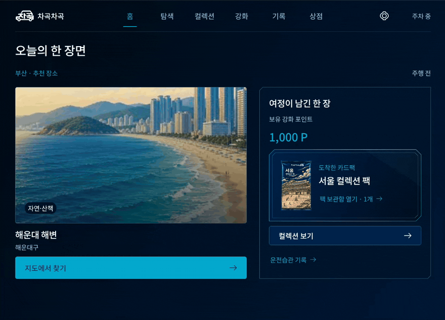</td>
    <td align="center">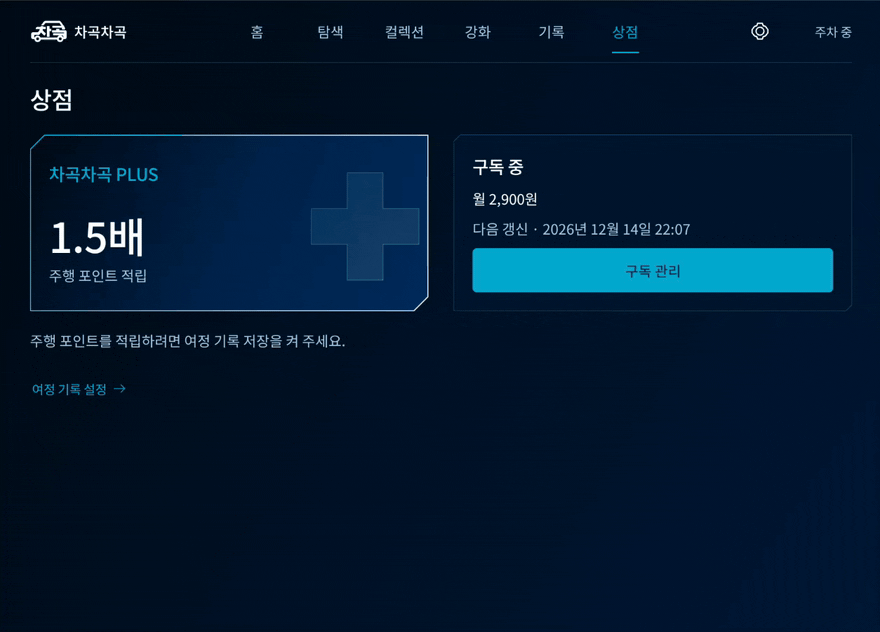</td>
  </tr>
</table>

<a id="demo"></a>

## Demo

[주행과 방문 보상](#demo-journey) · [PLUS 가입·해지](#demo-membership) · [팩 개봉과 컬렉션](#demo-collection) · [강화 단계와 결과](#demo-forge) · [한 장으로 +30까지](#demo-growth)

<a id="demo-journey"></a>

### 첫 팩에서 주행 보상과 강화까지

<table>
  <tr><th width="50%">첫 실행 · 차량 및 위치 권한</th><th width="50%">서울 선물팩 · 창경궁의 뜰</th></tr>
  <tr>
    <td align="center">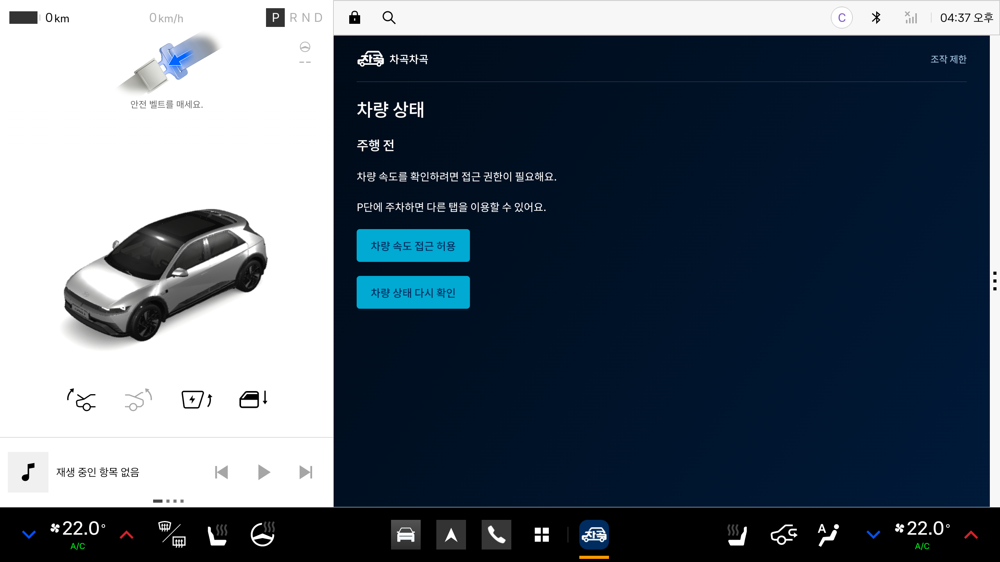</td>
    <td align="center"></td>
  </tr>
</table>

<table>
  <tr><th width="50%">출발 전 PLUS 구독</th><th width="50%">목적지 설정 · 현대 모터스튜디오 고양</th></tr>
  <tr>
    <td align="center">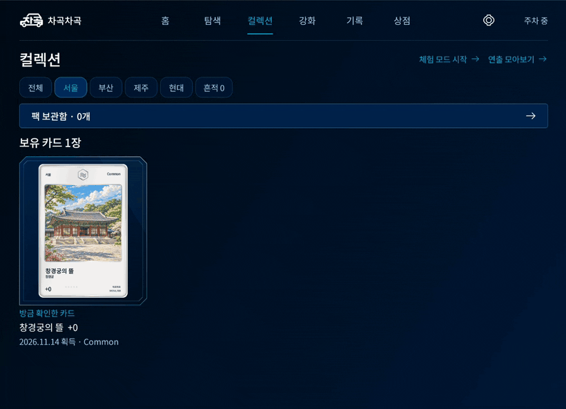</td>
    <td align="center">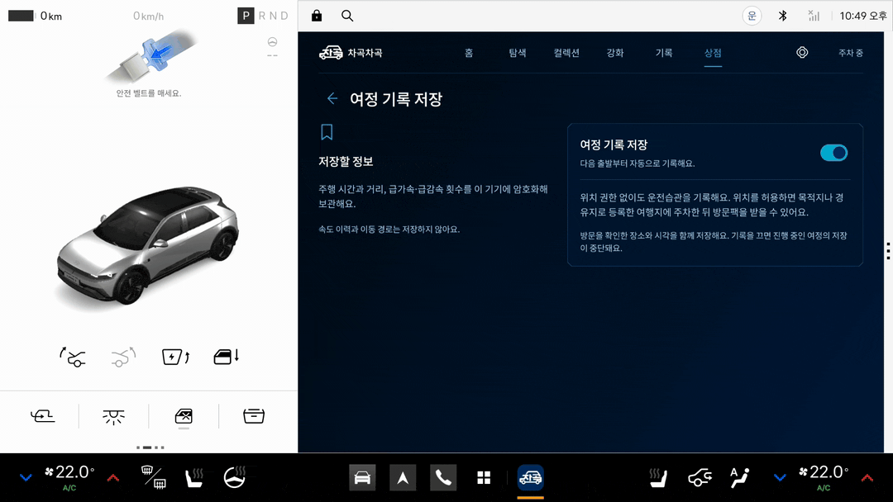</td>
  </tr>
</table>

<table>
  <tr><th width="50%">주행 기록과 경로 안내</th><th width="50%">도착 · 현대 방문팩과 238.5P</th></tr>
  <tr>
    <td align="center">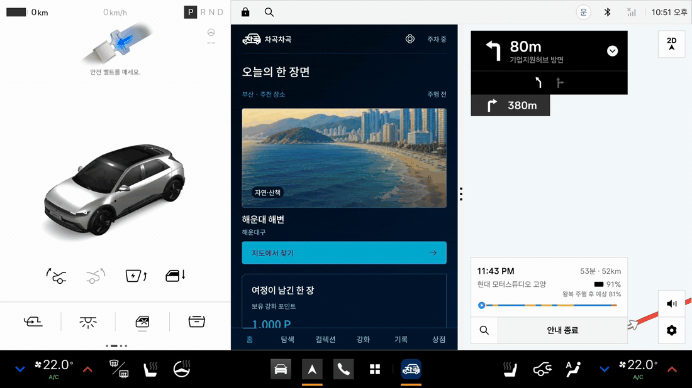</td>
    <td align="center">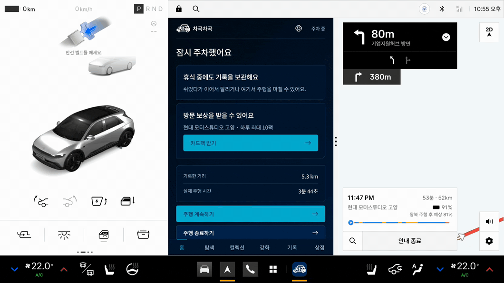</td>
  </tr>
</table>

<table>
  <tr><th width="50%">현대 팩 개봉 · 서초 UX 스튜디오</th><th width="50%">주행 포인트로 첫 강화</th></tr>
  <tr>
    <td align="center"></td>
    <td align="center">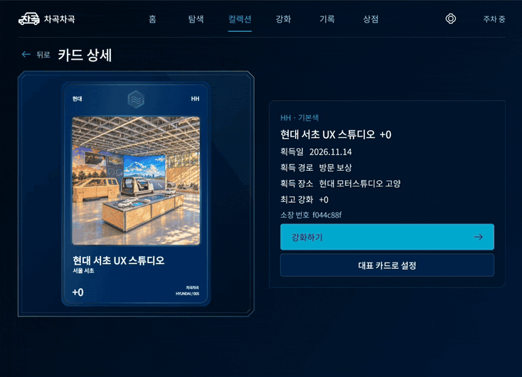</td>
  </tr>
</table>

<a id="demo-collection"></a>

### 부캉이 팩 개봉과 컬렉션

<table>
  <tr><th width="50%">봉투 열기</th><th width="50%">카드 공개와 상세 보기</th></tr>
  <tr>
    <td align="center">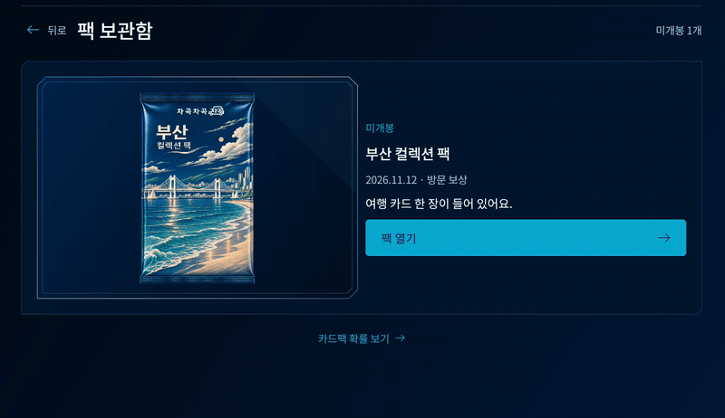</td>
    <td align="center">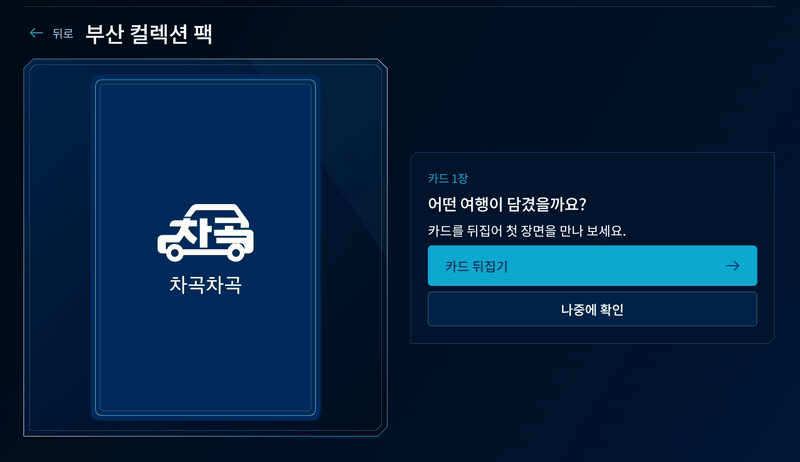</td>
  </tr>
</table>

<a id="demo-forge"></a>

### 강화 단계와 결과

<table>
  <tr><th width="50%">부캉이 외형 · +1, +10, +25</th><th width="50%">강화 결과와 흔적 복구</th></tr>
  <tr>
    <td align="center"></td>
    <td align="center">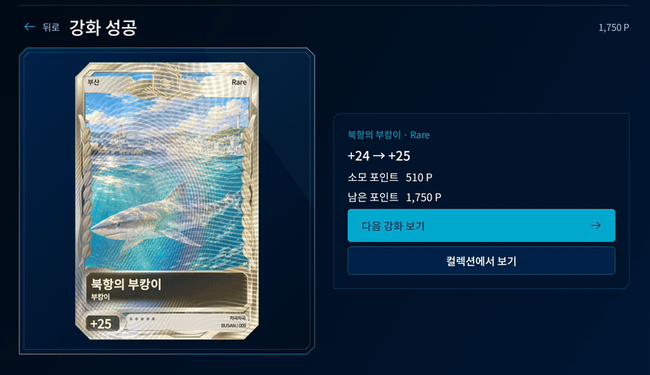</td>
  </tr>
</table>

<details>
<summary>단계별 강화 · +5부터 +30까지</summary>

<table>
  <tr><th width="50%">+4 → +5 · 메탈 프레임</th><th width="50%">+9 → +10 · 프리즘 장식</th></tr>
  <tr>
    <td align="center"></td>
    <td align="center"></td>
  </tr>
</table>

<table>
  <tr><th width="50%">+14 → +15 · 풀커버 원화</th><th width="50%">+19 → +20 · 크라운</th></tr>
  <tr>
    <td align="center">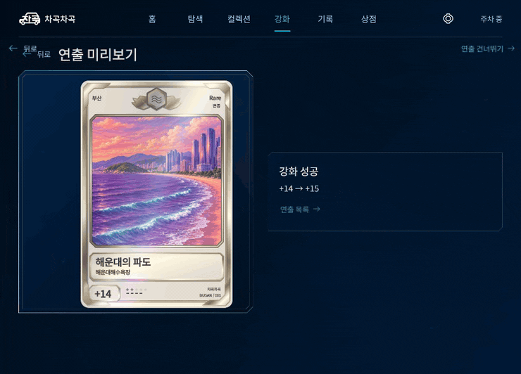</td>
    <td align="center">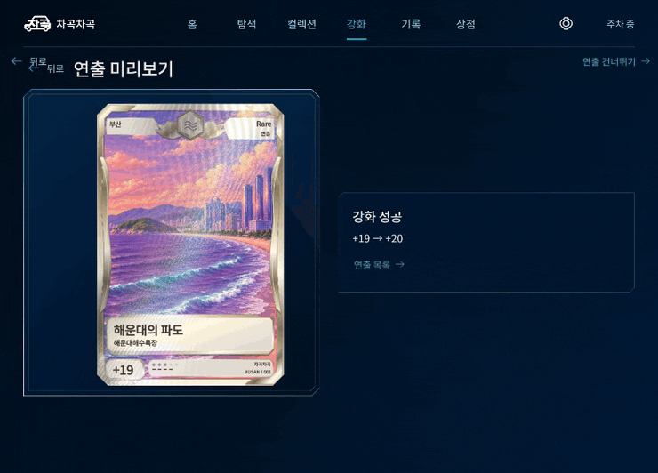</td>
  </tr>
</table>

<table>
  <tr><th width="50%">+24 → +25 · 월계 프레임</th><th width="50%">+25 → +26</th></tr>
  <tr>
    <td align="center"></td>
    <td align="center"></td>
  </tr>
</table>

<table>
  <tr><th width="50%">+26 → +27</th><th width="50%">+27 → +28</th></tr>
  <tr>
    <td align="center">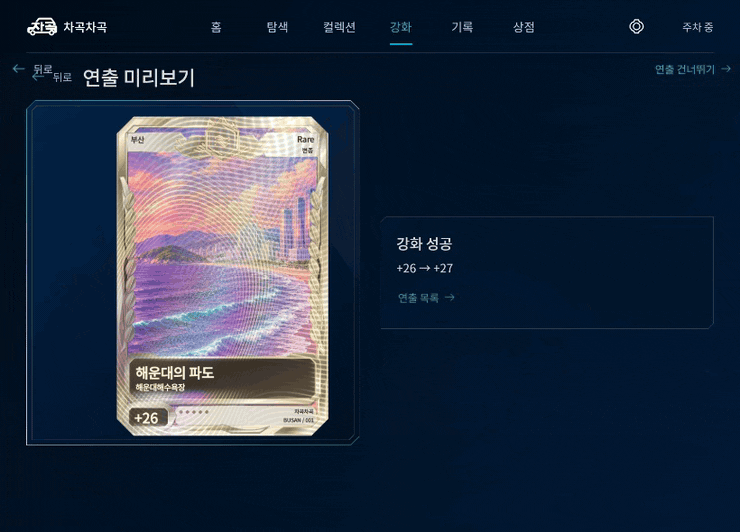</td>
    <td align="center"></td>
  </tr>
</table>

<table>
  <tr><th width="50%">+28 → +29</th><th width="50%">+29 → +30</th></tr>
  <tr>
    <td align="center"></td>
    <td align="center"></td>
  </tr>
</table>

</details>

<details>
<summary>강화 결과와 흔적 복구</summary>

<table>
  <tr><th width="50%">성공 · +12 → +13</th><th width="50%">대성공 · +14 → +16</th></tr>
  <tr>
    <td align="center">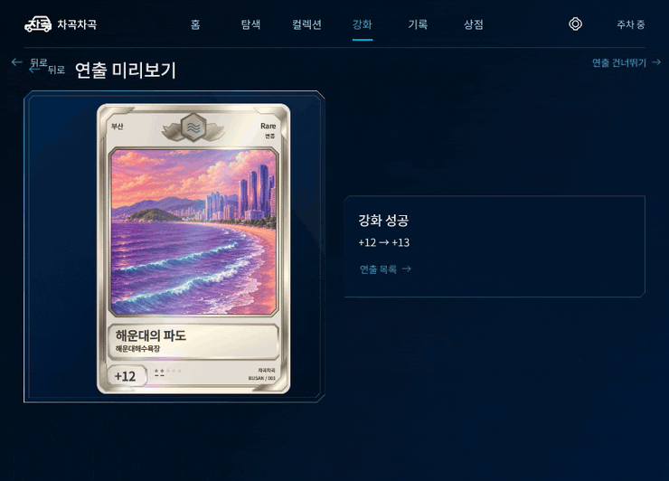</td>
    <td align="center"></td>
  </tr>
</table>

<table>
  <tr><th width="50%">유지 · +15</th><th width="50%">하락 · +15 → +14</th></tr>
  <tr>
    <td align="center"></td>
    <td align="center"></td>
  </tr>
</table>

<table>
  <tr><th width="50%">파괴 · +15 → 흔적 +10</th><th width="50%">복구 · 흔적 +10 → +10</th></tr>
  <tr>
    <td align="center"></td>
    <td align="center"></td>
  </tr>
</table>

</details>

<a id="demo-growth"></a>

### 한 장으로 +30까지

<details>
<summary>현대 모터스튜디오 고양(HH) · 팩 개봉부터 +30까지</summary>

<table>
  <tr><th width="50%">현대 팩 개봉 · 카드 상세</th><th width="50%">+0 → +4</th></tr>
  <tr>
    <td align="center"></td>
    <td align="center">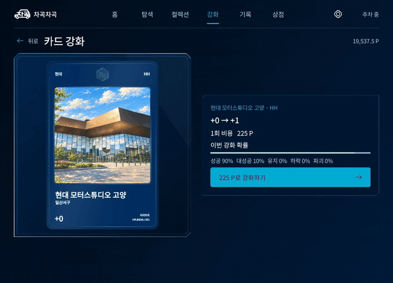</td>
  </tr>
</table>

<table>
  <tr><th width="50%">+4 → +9</th><th width="50%">+9 → +14</th></tr>
  <tr>
    <td align="center">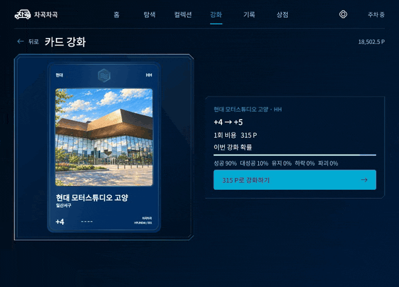</td>
    <td align="center"></td>
  </tr>
</table>

<table>
  <tr><th width="50%">+14 → +19</th><th width="50%">+19 → +24</th></tr>
  <tr>
    <td align="center">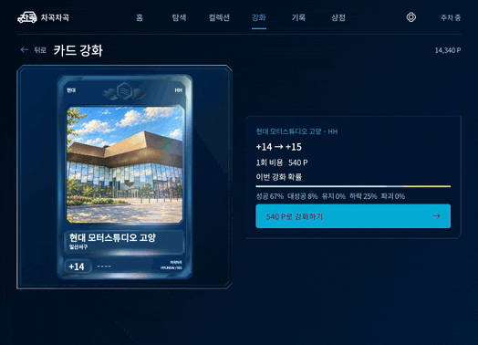</td>
    <td align="center">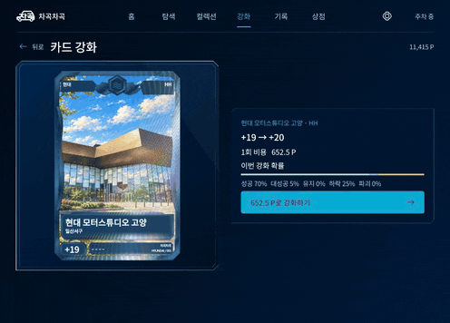</td>
  </tr>
</table>

<table>
  <tr><th width="50%">+24 → +28</th><th width="50%">+28 → +30</th></tr>
  <tr>
    <td align="center"></td>
    <td align="center"></td>
  </tr>
</table>

</details>

<a id="in-car-experience"></a>

## In-car experience

**달릴 때와 주차했을 때의 화면이 다릅니다.** 주행 중에는 기본 내비게이션 옆에서 기록 상태와 주변 추천 장소를 확인할 수 있습니다. 일반 탭 이동, 팩 개봉과 강화는 제한되며, D단에서 속도만 0이 되어도 이 제한은 풀리지 않습니다.

<table>
  <tr><th width="50%">주행 중 · 내비게이션과 주행 기록</th><th width="50%">주차 후 · 방문팩 수령</th></tr>
  <tr>
    <td align="center">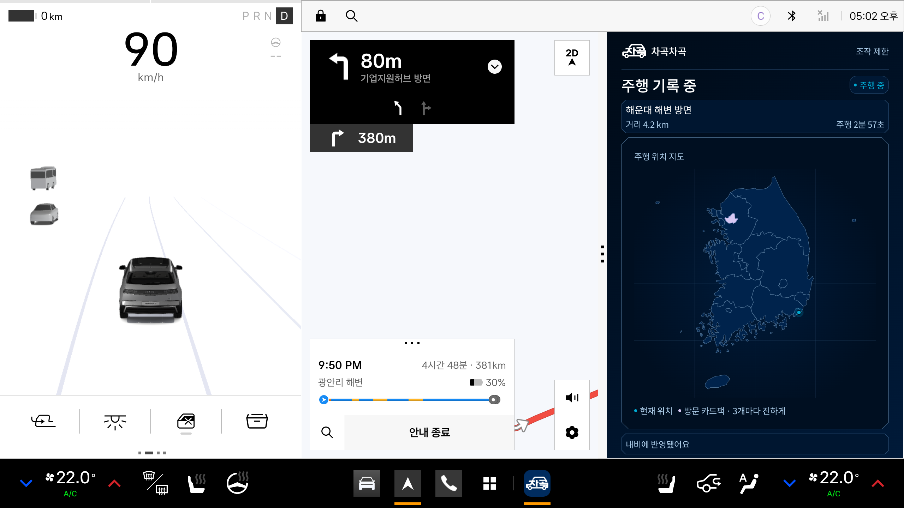</td>
    <td align="center">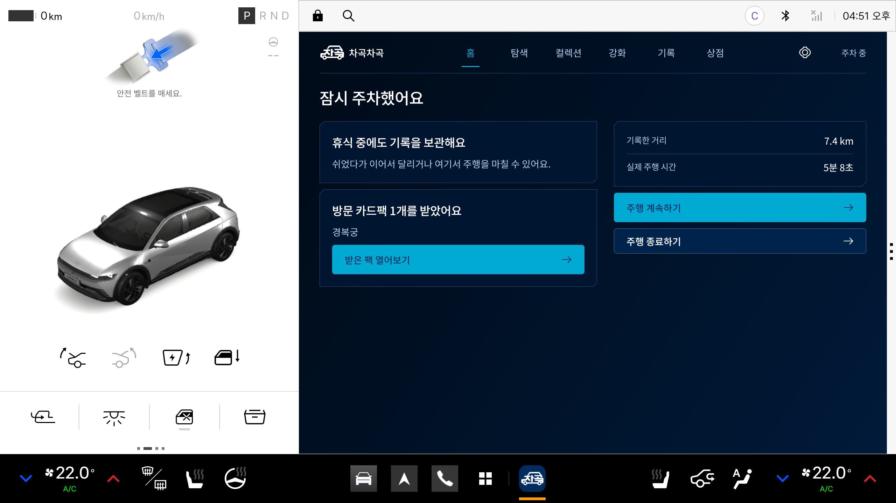</td>
  </tr>
</table>

P단 주차 후 팩을 받거나 여정을 끝낼 때는 화면 진입 시와 실행 시 모두 속도·기어 신호와 **Car UX Restrictions**를 확인합니다.

### Platform integration

| API / SDK | 사용처 |
| --- | --- |
| **Android Automotive Car API** | 속도·기어 수신, 주행 감지, 거리 분석과 주차 판단 |
| **Car UX Restrictions** | 차량 상태에 따라 허용되는 조작 확인 |
| **Pleos FusedLocation `1.1.3`** | 위치 업데이트와 방문 범위 검증 |
| **Pleos NaviHelper `3.0.5`** | 목적지·경유지 등록, 경로·도착 이벤트 구독 |

목적지나 경유지를 보내고 나면 경로와 목적지 상태를 다시 조회해 실제 반영을 확인합니다. **Pleos Connect 2.1.0 에뮬레이터**에서 검증했으며 실차 검증은 진행하지 않았습니다.

<a id="engineering"></a>

## Engineering

<a id="module-dependencies"></a>

### Architecture

화면의 ViewModel은 `core:domain`의 인터페이스를 사용합니다. 카드·포인트 저장은 `core:data`가, 차량 신호와 위치·내비게이션 연동은 `core:vehicle`이 구현합니다. 도메인의 강화 확률과 주행 적립 정책은 Android 없이 테스트할 수 있습니다.

<picture>
  <source media="(max-width: 600px)" srcset="docs/images/architecture-compact.svg">
  
</picture>

**카드 강화 한 번의 흐름:** `ForgeViewModel`이 `CardAlbumRepository.enhance()`를 호출하면 포인트 차감과 강화 결과가 하나의 Room 트랜잭션으로 확정됩니다. 새 앨범 상태는 Flow로 컬렉션과 강화 화면에 반영됩니다.

<details>
<summary>18개 모듈의 직접 코드 참조 보기</summary>

왼쪽 모듈이 오른쪽 모듈의 타입·함수·리소스를 사용합니다. 테스트와 DI 바인딩·화면 팩토리 등록만을 위한 의존은 제외했습니다. 같은 참조를 가진 모듈은 한 행에 묶었습니다.

| 참조하는 모듈 | 코드에서 직접 사용하는 모듈 |
| --- | --- |
| `:app` | `feature:main`, `feature:home`, `feature:collection`, `core:designsystem`, `core:navigation`, `core:domain` |
| `feature:main` | `feature:nav`, `core:designsystem`, `core:navigation`, `core:domain`, `core:ui` |
| `feature:nav` | `core:designsystem`, `core:navigation` |
| `feature:home`, `feature:explore`, `feature:records` | `core:designsystem`, `core:navigation`, `core:domain`, `core:ui` |
| `feature:collection`, `feature:forge` | `core:card-ui`, `core:designsystem`, `core:navigation`, `core:domain`, `core:ui` |
| `feature:membership` | `core:designsystem`, `core:domain`, `core:navigation` |
| `feature:settings` | `core:designsystem`, `core:navigation` |
| `core:card-ui` | `core:designsystem`, `core:domain` |
| `core:data` | `core:domain`, `core:database` |
| `core:vehicle`, `core:navigation` | `core:domain` |
| `core:domain`, `core:database`, `core:designsystem`, `core:ui` | 다른 프로젝트 모듈을 참조하지 않음 |

`app`은 홈에 컬렉션의 대표 카드를 연결합니다. `feature:main`은 `feature:nav`의 `PleosNavDisplay`로 탭을 그리고, 설정·구독 화면은 `core:navigation`의 라우터로 다른 화면을 엽니다. `build-logic:convention`은 별도 Gradle 빌드에 둔 빌드 플러그인입니다.

</details>

### Implementation notes

| Topic | Approach |
| --- | --- |
| **Atomic persistence** | 방문 보상 지급, 팩 개봉, 강화 결과를 Room transaction으로 확정 |
| **Idempotency** | 정산 ID·`requestId`로 중복 적립/강화 요청을 방지 |
| **Optimistic concurrency** | 카드 `revision`과 데이터 `generation`으로 오래된 작업의 반영을 차단 |
| **Navigation consistency** | NaviHelper 요청 후 route/destination state를 다시 확인 |
| **Graphics pipeline** | Compose Canvas · Android Canvas · AGSL, OS 버전에 따른 fallback |
| **Render preparation** | 카드 뒷면 노출 중 이미지 로드 및 `ImageBitmap.prepareToDraw()` 선행 |

랜덤한 보상과 강화 결과는 **한 번 확정되면 재시도해도 바뀌지 않아야 합니다.** 그래서 화면 애니메이션과 영속 상태를 분리하고, 중간 종료·중복 요청·오래된 상태에서의 재시도를 독립적으로 처리했습니다.

<details>
<summary>Reward rules, persistence & rendering details</summary>

#### Vehicle state & UX restrictions

차량 속도·기어는 Android Automotive Car API로 구독하고, 플랫폼의 `Car UX Restrictions`와 함께 조작 가능 여부를 판단합니다. 위치와 기본 내비게이션 연결에는 Pleos FusedLocation `1.1.3`, NaviHelper `3.0.5`를 사용합니다.

- **Driving / restricted** — 주행 정보를 표시하되 탭 이동, 팩 개봉, 강화 조작을 제한합니다.
- **Parked / unrestricted** — P 기어, 정지, 유효한 차량 신호, 플랫폼 제한 해제가 확인되면 상호작용을 허용합니다.
- **Unknown / connecting** — 신호가 불명확한 경우 제한 해제를 보류합니다.

UI가 버튼을 표시할 때와 실제 동작을 수행할 때 상태를 각각 검사합니다. 내비게이션 분할 창과 넓은 앱 창에서 타이포 및 화면 배치를 조정합니다.

##### Navigation consistency

`NaviHelper`의 요청이 성공을 반환했다고 해서 내비게이션 상태가 실제로 변경되었다고 가정하지 않습니다. 목적지/경유지와 route를 다시 확인하고, 실패·시간 초과·확인 중 상태를 구분합니다. 홈과 탐색은 장소 세션을 공유하고, 마지막 구독자가 사라지면 SDK listener와 위치 callback을 해제합니다.

#### Transactional persistence

| Operation | Guarantee |
| --- | --- |
| Visit reward | 방문 수령 기록과 sealed pack을 하나의 DB transaction으로 저장 |
| Pack opening | 추첨 결과와 앞면 공개 여부를 분리해 중간 종료 후 복원 |
| Enhancement | 포인트 차감, 카드 변경, 최고 기록, 결과 영수증을 원자적으로 확정 |
| Retry | `requestId` 재요청에는 같은 결과를 반환 |
| Concurrency | 카드 `revision`으로 stale write 차단 |
| 데이터 초기화 | `generation` 검사로 초기화 이전에 시작한 요청의 반영 방지 |

결과 애니메이션은 영속 상태의 성공 여부를 결정하지 않습니다. 결과가 먼저 확정되며, 화면을 다시 열어도 같은 결과를 재구성합니다.

#### Driving analytics

기록된 speed sample의 timestamp를 사용해 거리를 적분하고 가속도 변화를 분석합니다.

| Metric | Rule |
| --- | --- |
| Rapid acceleration | `2.5 m/s²` 이상 `0.6 s` 유지 |
| Rapid deceleration | `3.0 m/s²` 이상 `0.6 s` 유지 |
| Event release | `0.8 s` 조건으로 중복 집계 감소 |
| Safety score | `round(100 − 60 × 급가속 횟수 / max(5, 이동 시간[분]))`, 0–100 제한 |

급제동 횟수는 기록하지만 현재 안전 점수에는 반영하지 않습니다. 신호 품질이 충분하지 않은 여정은 기록을 보관하되 안전 점수 및 포인트를 산출하지 않습니다.

##### Reward settlement

실제 거리 `2 km` 이상이면서 분석이 완료된 여정에 적용합니다. 주간 인정 주행 거리는 한국 시간 월요일 시작 기준 최대 `1,000 km`입니다.

```text
Eligible distance = min(driven distance, remaining weekly allowance)
Base points = floor(eligible distance [km] × 20P × (safety score / 100 × 1.5))
PLUS extra points = floor(base points × subscribed distance / total distance) / 2
```

예: `25 km`, 안전 점수 `80`인 경우 일반 `600P`, 전 구간 PLUS 사용 시 `900P`. 포인트는 `0.5P`를 표현할 수 있는 정수 단위로 저장하며 settlement ID로 중복 적립을 막습니다. 주 경계를 넘는 여정은 주별 거리 분할 자료가 없어 기록만 보관합니다.

#### Visit rewards & card upgrades

##### Visit packs

- 등록된 목적지 또는 경유지의 인정 범위에 도착하고 주차해야 보상을 수령할 수 있습니다.
- 하루 최대 `10회`, 같은 지역은 `14일`의 재수령 간격을 적용합니다.
- 일반 지역팩은 `Common` / `Rare` / `Epic`, 현대 팩은 `H` / `HH` 등급을 사용합니다.
- 일반 지역팩의 색상 변종 확률은 `5%`, 현대 팩은 `0%`입니다.

##### Enhancement rules

```text
Cost = (100 + 10 × current level) P × rarity multiplier

Common      ×1.00
Rare / H    ×1.50
Epic / HH   ×2.25
```

현재 프로토타입에서는 유지·파괴가 `0%`이며, +20부터 성공 `70%` / 하락 `30%`를 사용합니다. +0–19의 대성공은 +2로 처리합니다. 표시 확률과 결과 추첨은 동일한 `CardRules`를 사용합니다.

#### Card rendering pipeline

카드 재질 및 효과는 Compose Canvas, Android Canvas, AGSL로 구현합니다. Android 13 이상에서는 AGSL 반사를 사용하며, 하위 버전에는 Canvas fallback을 제공합니다.

- 강화 단계에 따라 frame, foil, prism, full-cover artwork를 다르게 표현합니다.
- 카드 크기·기울기·반사 상태를 화면 전환과 결과 연출 사이에서 이어갑니다.
- 카드 뒷면이 노출된 동안 `Dispatchers.IO`에서 원화와 프레임을 로드하고, `ImageBitmap.prepareToDraw()`로 그리기를 준비합니다.
- 첫 프레임에 레이아웃/재질 초기 작업이 몰리지 않도록 사전 준비하며, 접근성 정보는 실제 카드 공개 시점에 맞춰 노출합니다.


</details>

### Tech stack

| Category | Technologies |
| --- | --- |
| **Language** | Kotlin `2.2.10` |
| **UI** | Jetpack Compose · Material 3 · Custom Design System |
| **Architecture** | MVVM · UDF · Multi-module · Repository Pattern |
| **DI** | Hilt `2.59.2` |
| **Concurrency** | Kotlin Coroutines `1.10.2` · Flow · StateFlow |
| **Navigation** | Navigation 3 `1.2.0` |
| **Persistence** | Room `2.8.4` · SQLCipher `4.14.1` · Android Keystore |
| **Automotive** | Android Car API · Car UX Restrictions · Pleos SDK |
| **Map & Graphics** | MapLibre `13.7.1` · Compose Canvas · AGSL |
| **Build & Quality** | AGP `9.4.1` · Gradle `9.6.0` · Convention Plugins · JUnit · Compose UI Test · Lint · Spotless / ktlint · GitHub Actions |


<a id="build--run"></a>

## Build & run

### 제출용 APK

[차곡차곡 1.0 서명 APK 다운로드](apk/가차_차곡차곡_release.apk?raw=true) (84.4 MiB)

Pleos Connect 에뮬레이터를 실행한 뒤, APK를 내려받은 폴더에서 설치합니다.

```bash
adb install -r '가차_차곡차곡_release.apk'
```

### 소스에서 빌드하기

**Requirements**

- Android Studio — AGP `9.4.1` 지원 버전
- JDK `25` (프로젝트 CI 기준)
- Android SDK Platform `37.0` (`minSdk 28` / `compileSdk 37` / `targetSdk 37`)
- Pleos Connect emulator `2.1.0` — 검증 환경: Android Automotive / Android 14, API 34, ARM64

```bash
git clone https://github.com/Pleos-Safe/Android.git
cd Android
./gradlew :app:assembleDebug

# 설치 대상은 adb devices 결과로 확인
adb devices
adb -s emulator-5554 install -r app/build/outputs/apk/debug/app-debug.apk
```

1. Pleos Connect 에뮬레이터를 실행한 뒤 빌드한 APK를 설치합니다.
2. 차량 홈의 앱 라이브러리에서 **차곡차곡**을 열고 [첫 실행 화면](docs/qa/chagok-2026-11-13/00-fresh-profile-first-screen.png)의 안내에 따라 차량 신호와 위치 권한을 허용합니다.
3. 실제 주행을 기록하려면 출발 전에 **기록 → 저장 설정 → 여정 기록 저장**을 켭니다.
4. **P 기어·정지 상태**에서 장소를 탐색하거나 선물팩을 열 수 있습니다.

**연출 모아보기**는 Debug 빌드의 **컬렉션**과 **강화** 탭에서만 열 수 있습니다. 실제 카드나 포인트를 쓰지 않고 팩 개봉과 강화를 미리 볼 수 있으며, 제출용 Release에는 이 메뉴가 없습니다.

`local.properties`에는 로컬 Android SDK 경로를 설정합니다. 위치 및 내비게이션 연동은 실행 환경의 서비스 연결과 인터넷이 필요합니다.

### Test environment

| Environment | Verified configuration |
| --- | --- |
| Pleos Connect emulator | `2.1.0` |
| OS / ABI | Android Automotive · Android 14 / API 34 · ARM64-v8a |
| Display | `2560 × 1440px` · `160dpi` |
| Window | 차량 시스템과 앱 영역 · 내비게이션과 앱의 분할 창 |

### Tests & checks

```bash
./gradlew testDebugUnitTest :core:domain:test --continue
./gradlew spotlessCheck
./gradlew lintDebug lintRelease --continue
./gradlew :build-logic:convention:check
```


<sub>Developed for the Hyundai Motor Group Pleos Connect vehicle app development competition.</sub>
