<div align="center">

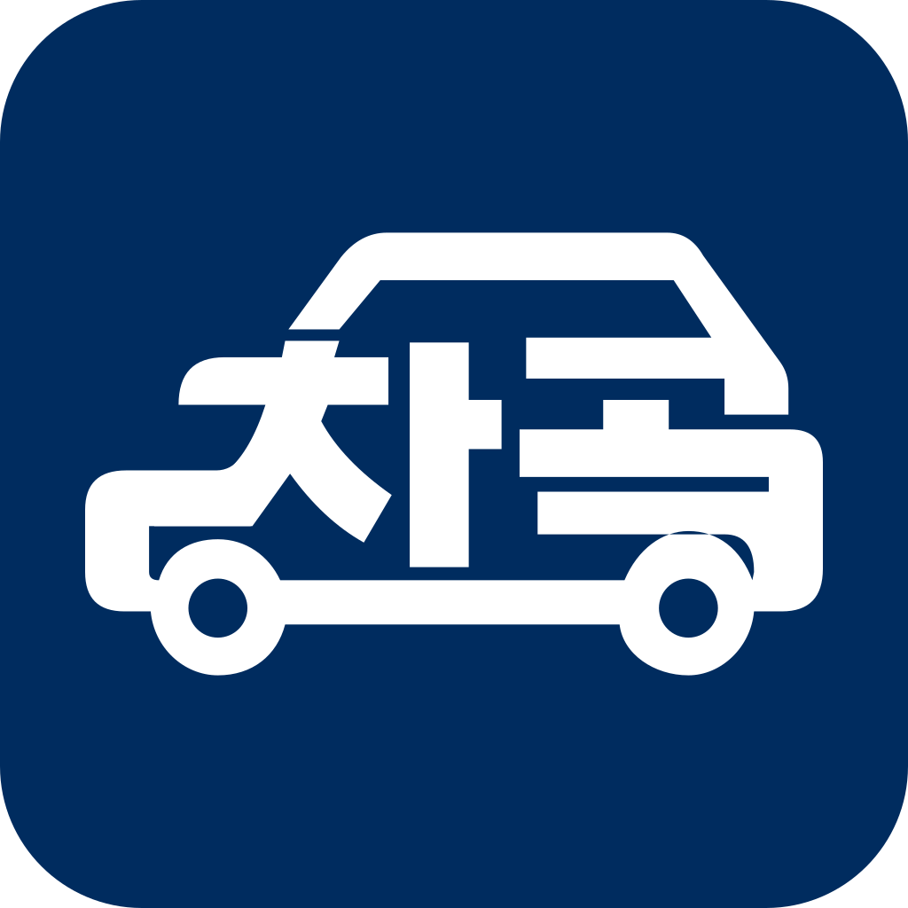

# 차곡차곡

**주행은 포인트로, 방문은 카드로.**

달린 거리로 포인트를 모으고, 다녀온 곳에서 얻은 카드를 한 장씩 키우는 차량용 앱입니다.

[주요 기능](#features) · [시연 영상](#demo) · [차량에서의 사용](#in-car-experience) · [아키텍처와 구현](#engineering) · [빌드 및 실행](#build--run)


<sub>Pleos Connect 2.1.0 · 주차 후 홈에서 본 추천 장소와 나의 대표 카드</sub>

</div>

## Overview

어디를 다녀왔는지는 기억해도, 그곳까지 달린 시간은 쉽게 잊힙니다. **차곡차곡**은 긴 운전 끝에 기다릴 작은 즐거움을 만듭니다. 평소처럼 달린 날에는 강화 포인트가, 새로운 장소를 찾아간 날에는 그 지역의 카드팩이 남습니다. 차를 세우고 봉투를 열면, 다음 주행에서 키우고 싶은 카드가 생깁니다.

<a id="features"></a>

## Features

### 01 — 주행과 방문 보상

출발 전 탐색에서 목적지나 경유지를 등록하면 차량의 기본 내비게이션에 반영됩니다. **방문 보상과 주행 정산은 별개**입니다. 등록한 장소에 도착하면 P단에 주차해 여정을 끝내기 전에 방문팩을 받고, 주행을 종료하면 거리와 안전점수에 따라 포인트를 받습니다. 장소를 방문하지 않은 일상 주행도 적립 대상입니다.


실제 화면 캡처를 순서대로 담았습니다. 경복궁에서는 주차 후 서울 방문팩을 받고, 여정을 종료해 **7.4km · 안전점수 100점으로 221P**를 적립했습니다. 별도로 기록한 1.8km 여정은 2km 미만이라 포인트가 0P였습니다.

### 02 — 카드팩 개봉과 컬렉션

서울·부산·제주·현대, 네 종류의 팩에 **45종의 기본 도안**이 있습니다. 처음에는 서울 선물팩 하나와 1,000P로 시작합니다. 팩 보관함에서 봉투를 뜯고, 나온 카드의 뒷면을 직접 뒤집어 그림과 등급을 확인합니다.

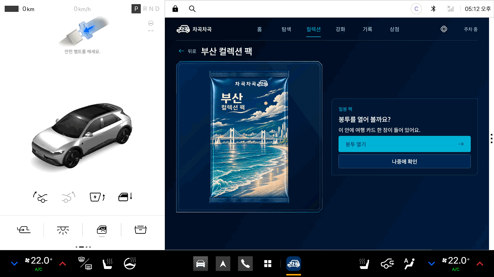

광안리에서 받은 부산 팩을 열었더니 ‘북항의 부캉이’(Rare)가 나왔습니다. 카드의 장소와 방문한 곳이 달라도, 지도에는 팩을 받은 지역이 칠해집니다.

<details>
<summary>재실행 후 홈 · 주행 기록 · 컬렉션 보기</summary>


</details>

### 03 — 카드 강화

컬렉션에서 마음에 드는 카드를 골라 주행 포인트를 씁니다. **+5·+10·+15·+20·+25**마다 프레임과 재질이 바뀌고, **+15부터는 원화가 카드 전체를 덮습니다.** 카드를 기울이면 포일과 프리즘의 반사광도 각도에 따라 움직입니다.


위에서 얻은 부캉이에 **150P**를 썼고, 대성공으로 **+0 → +2**가 됐습니다. 다시 실행한 뒤에도 강화 수치와 대표 카드 선택이 그대로 홈에 표시됩니다.

<a id="demo-membership"></a>

### 04 — PLUS 구독

상점에서 PLUS(월 2,900원)를 시작하면 **구독이 적용된 주행 구간**의 포인트가 1.5배가 됩니다. 설정에서 자동 갱신을 꺼도 이미 시작한 이용 기간까지 혜택이 유지됩니다. 결제는 모의 처리하며 실제 청구는 없습니다.


<details>
<summary>설정에서 구독 해지를 예약하고 자동 갱신을 다시 켜는 장면</summary>


</details>

<a id="demo"></a>

## Demo

[주행과 방문 보상](#demo-journey) · [PLUS 가입·해지](#demo-membership) · [팩 개봉과 컬렉션](#demo-collection) · [강화 단계와 결과](#demo-forge) · [한 장으로 +30까지](#demo-growth)

<a id="demo-journey"></a>

### 첫 팩에서 주행 보상과 강화까지

Pleos Connect 2.1.0에서 차곡차곡의 첫 실행부터 방문 카드 강화까지 촬영했습니다. 목적지 설정과 주행·정산은 기본 내비게이션과 계기판이 함께 보이는 차량 전체 화면입니다.

**첫 카드**　새 프로필로 시작해 서울 선물팩을 뜯고 첫 카드 ‘창경궁의 뜰’을 뒤집습니다.

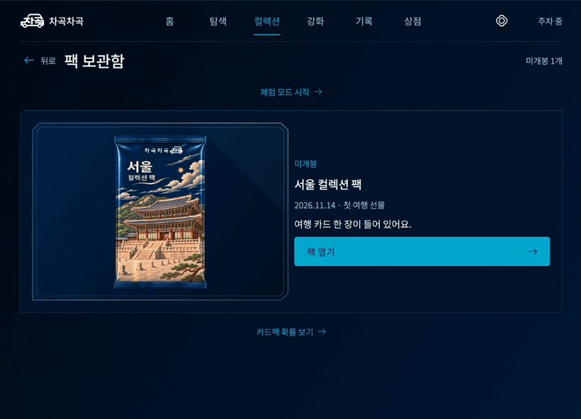

**출발 준비**　상점에서 월 2,900원 PLUS를 구독합니다.


**목적지 설정**　앱과 기본 내비게이션을 나란히 띄운 뒤, 탐색에서 현대 모터스튜디오 고양을 목적지로 보냅니다.


**주행**　계기판의 속도가 올라가면서 앱이 주행 기록 화면으로 바뀝니다. 긴 이동 구간은 원본 녹화에서 생략했습니다.


**도착과 보상**　고양에서 P단으로 주차해 현대 팩을 받고 주행을 종료합니다. 5.3km를 달려 안전점수 100점을 받았습니다. 기본 159P에 PLUS 79.5P가 더해져 **238.5P**가 적립됐습니다.


**현대 팩 개봉**　주차 후 앱 창을 펼치고, 받은 현대 팩에서 ‘현대 서초 UX 스튜디오’(HH)를 공개합니다.

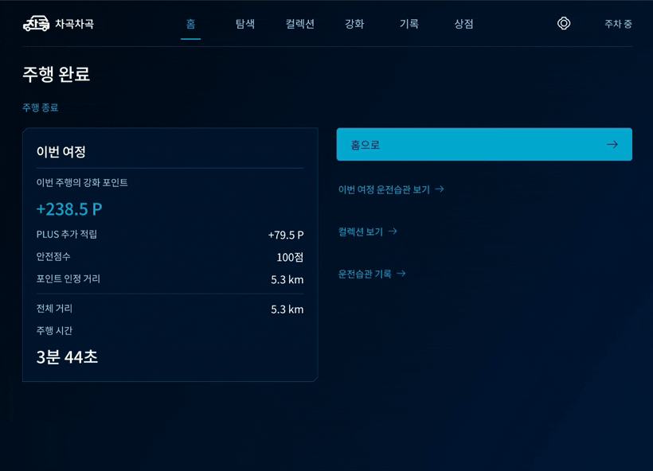

**주행 포인트로 첫 강화**　225P를 써서 방금 얻은 카드를 강화합니다. 이번 시도는 대성공으로 **+0 → +2**가 됐고, 잔액은 1,238.5P에서 1,013.5P로 줄었습니다.


<a id="demo-collection"></a>

### 부캉이 팩 개봉과 컬렉션

| 봉투 열기 | 카드 공개와 상세 보기 |
| --- | --- |
|  |  |

<details>
<summary>Common · Rare · Epic · H · HH의 카드 공개 연출 비교</summary>

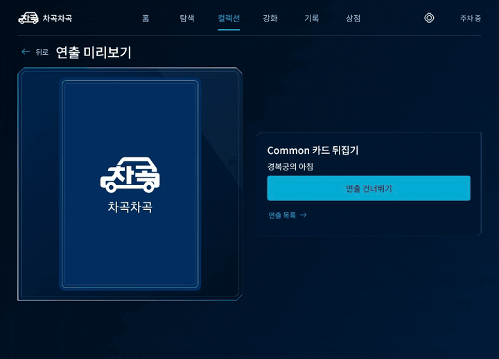

</details>

<a id="demo-forge"></a>

### 강화 단계와 결과

다음 두 GIF는 ‘북항의 부캉이’의 강화 수치와 결과를 고정해 촬영했습니다.

| +1 · +10 · +25 외형 비교 | 대성공 · 하락 · 잔액 부족 · 흔적 복구 |
| --- | --- |
| 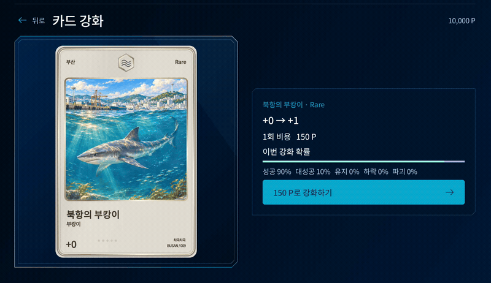 |  |

<details>
<summary>프레임과 재질이 바뀌는 순간 · +5, +10, +15, +20, +25</summary>

| +4 → +5 · 메탈 프레임 | +9 → +10 · 프리즘 장식 |
| --- | --- |
| 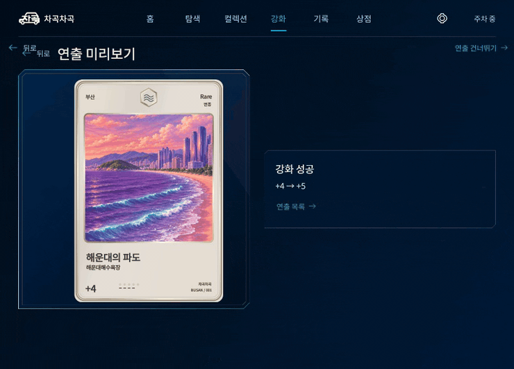 | 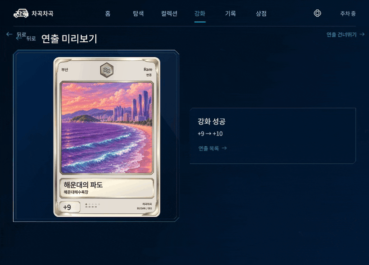 |

| +14 → +15 · 풀커버 원화 | +19 → +20 · 크라운 |
| --- | --- |
|  |  |

**+24 → +25 · 월계 프레임**

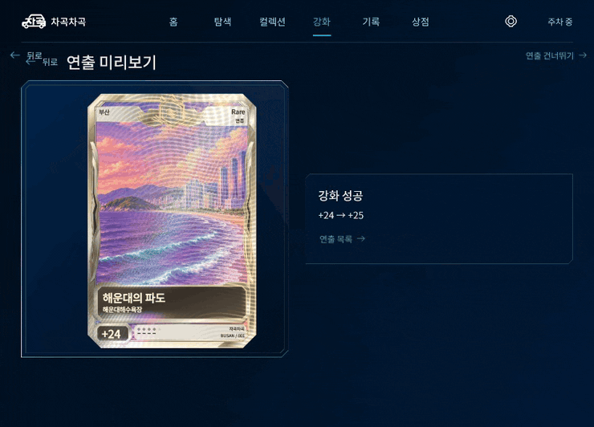

</details>

<details>
<summary>+25 이후 한 단계씩 · +26, +27, +28, +29, +30</summary>

| +25 → +26 | +26 → +27 |
| --- | --- |
|  |  |

| +27 → +28 | +28 → +29 |
| --- | --- |
| 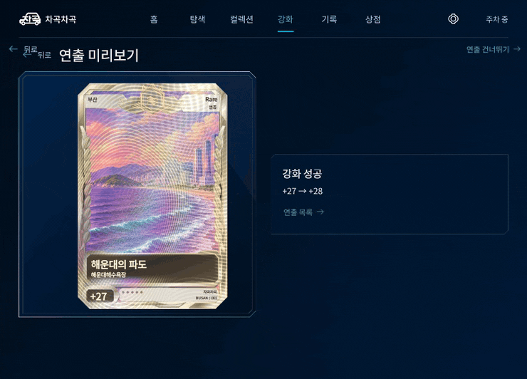 |  |

**+29 → +30**

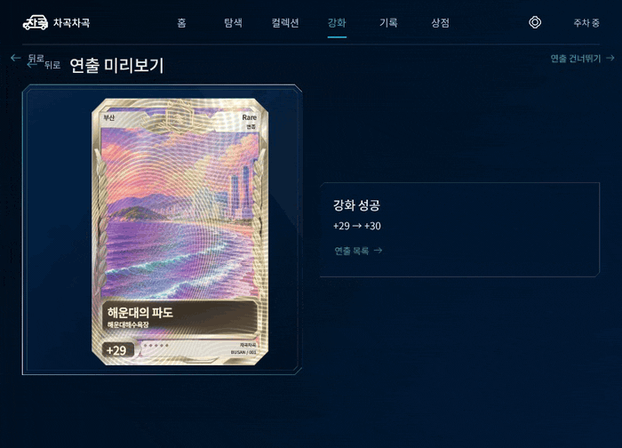

</details>

<details>
<summary>강화 결과 5종과 흔적 복구 · 성공, 대성공, 유지, 하락, 파괴</summary>

유지와 파괴는 현재 일반 강화에서 확률이 0%입니다. 아래 여섯 GIF는 차곡차곡의 연출 미리보기에서 결과를 지정해 촬영했습니다. +15 카드가 파괴되면 +10 흔적이 되고, 같은 카드의 +0 사본을 사용해 +10으로 복구합니다.

| 성공 · +12 → +13 | 대성공 · +14 → +16 |
| --- | --- |
|  | 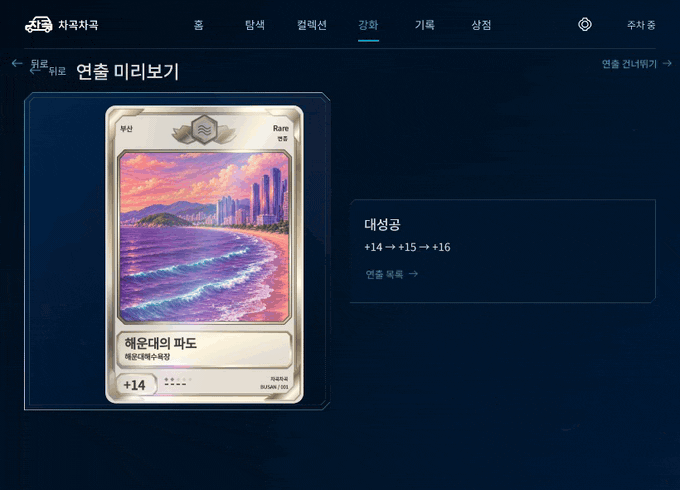 |

| 유지 · +15 | 하락 · +15 → +14 |
| --- | --- |
| 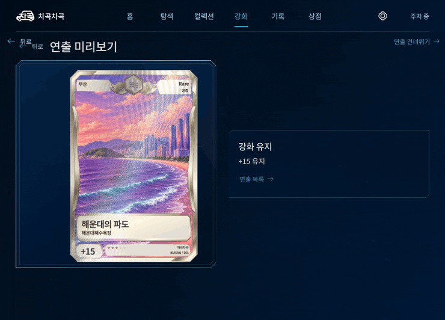 | 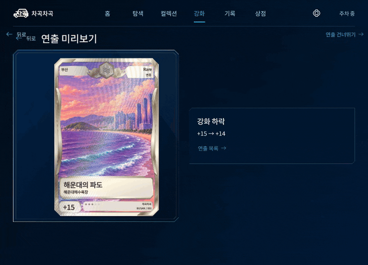 |

| 파괴 · +15 → 흔적 +10 | 복구 · 흔적 +10 → +10 |
| --- | --- |
| 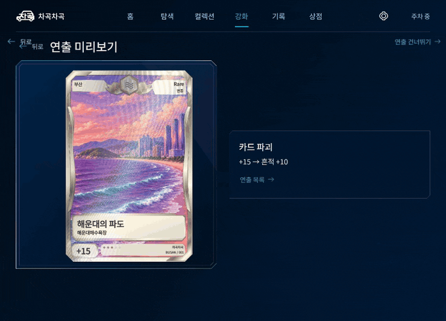 | 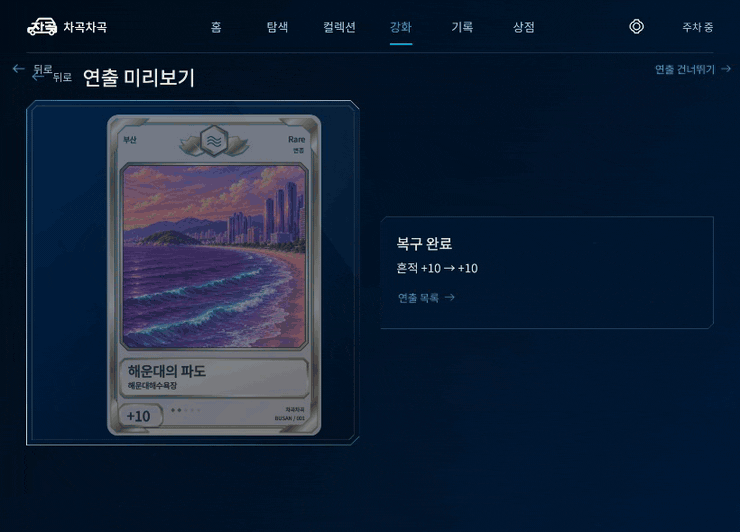 |

</details>

<a id="demo-growth"></a>

### 한 장으로 +30까지

현대 모터스튜디오 고양(HH) 한 장이 +0에서 +30까지 변하는 모습입니다. 현대 방문팩이 보관함에 들어온 상태에서 시작하며, 이 시연에서는 뽑히는 카드와 각 강화의 성공 결과를 고정했습니다.

<details>
<summary>현대 팩 개봉 · 카드 공개 · +0부터 +30까지 전 구간</summary>

| 방문팩 보관함 → 개봉 → 카드 상세 | +0 → +4 |
| --- | --- |
| 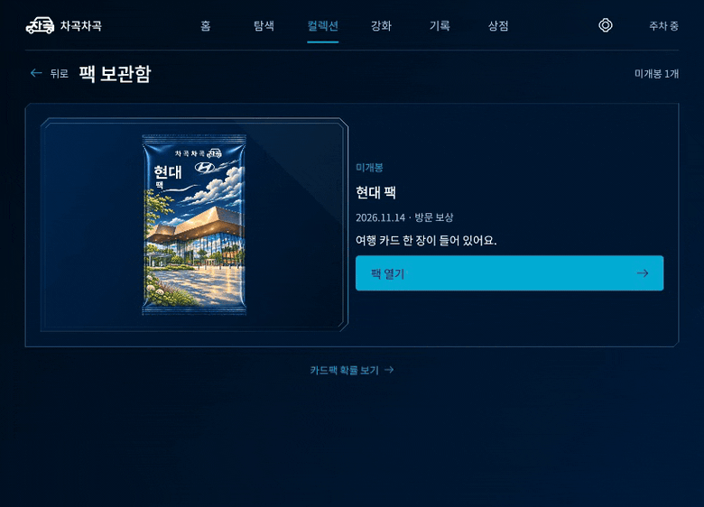 |  |

| +4 → +9 | +9 → +14 |
| --- | --- |
|  | 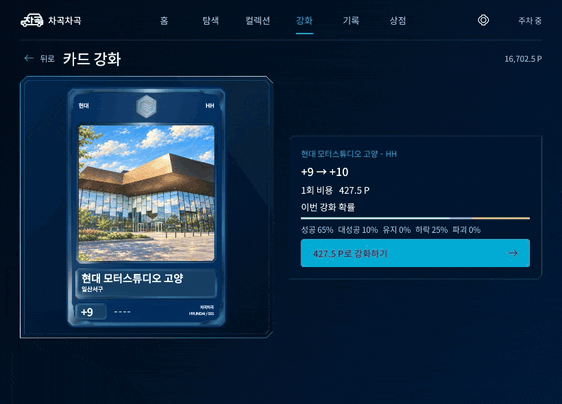 |

| +14 → +19 | +19 → +24 |
| --- | --- |
|  |  |

| +24 → +28 | +28 → +30 |
| --- | --- |
| 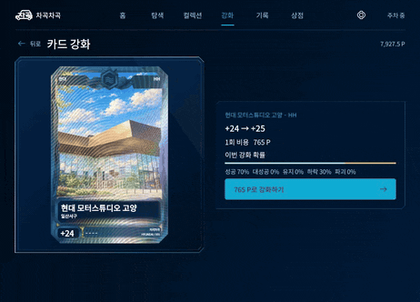 | 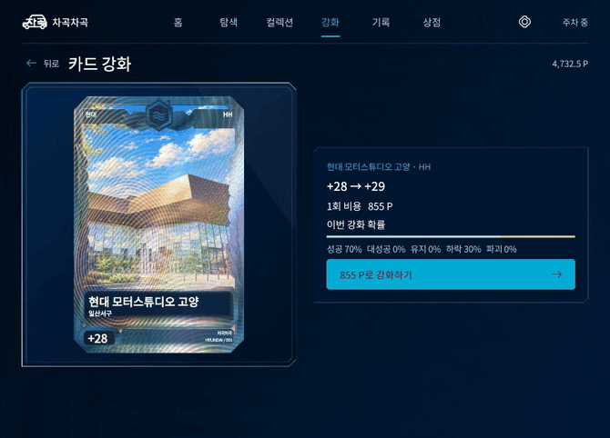 |

</details>

<a id="in-car-experience"></a>

## In-car experience

**달릴 때와 주차했을 때의 화면이 다릅니다.** 주행 중에는 기본 내비게이션 옆에서 기록 상태와 주변 추천 장소를 확인할 수 있습니다. 일반 탭 이동, 팩 개봉과 강화는 제한되며, D단에서 속도만 0이 되어도 이 제한은 풀리지 않습니다.


부산에서 두 경유지를 등록하고 고양을 거쳐 협재까지 달린 이 여정에서는 **기본 434P + PLUS 217P = 651P**를 받았습니다. 방문 지도에는 팩을 수령한 지역이 남습니다. P단 주차 후 팩을 받거나 여정을 끝낼 때는 화면 진입 시와 실행 시 모두 속도·기어 신호와 **Car UX Restrictions**를 확인합니다.

### Platform integration

| API / SDK | 사용처 |
| --- | --- |
| **Android Automotive Car API** | 속도·기어 수신, 주행 감지, 거리 분석과 주차 판단 |
| **Car UX Restrictions** | 차량 상태에 따라 허용되는 조작 확인 |
| **Pleos FusedLocation `1.1.3`** | 위치 업데이트와 방문 범위 검증 |
| **Pleos NaviHelper `3.0.5`** | 목적지·경유지 등록, 경로·도착 이벤트 구독 |

목적지나 경유지를 보내고 나면 경로와 목적지 상태를 다시 조회해 실제 반영을 확인합니다. **Pleos Connect 2.1.0 에뮬레이터**에서 검증했으며 실차 검증은 진행하지 않았습니다.

<a id="engineering"></a>

## Engineering

<a id="module-dependencies"></a>

### Architecture

화면의 ViewModel은 `core:domain`의 인터페이스를 사용합니다. 카드·포인트 저장은 `core:data`가, 차량 신호와 위치·내비게이션 연동은 `core:vehicle`이 구현합니다. 도메인의 강화 확률과 주행 적립 정책은 Android 없이 테스트할 수 있습니다.

<picture>
  <source media="(max-width: 600px)" srcset="docs/images/architecture-compact.svg">
  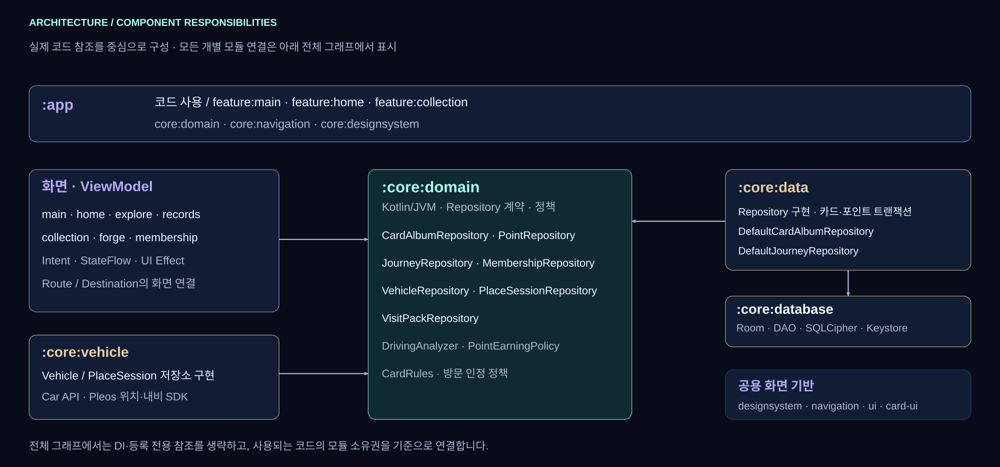
</picture>

**카드 강화 한 번의 흐름:** `ForgeViewModel`이 `CardAlbumRepository.enhance()`를 호출하면 포인트 차감과 강화 결과가 하나의 Room 트랜잭션으로 확정됩니다. 새 앨범 상태는 Flow로 컬렉션과 강화 화면에 반영됩니다.

<details>
<summary>18개 모듈의 직접 코드 참조 보기</summary>

왼쪽 모듈이 오른쪽 모듈의 타입·함수·리소스를 사용합니다. 테스트와 DI 바인딩·화면 팩토리 등록만을 위한 의존은 제외했습니다. 같은 참조를 가진 모듈은 한 행에 묶었습니다.

| 참조하는 모듈 | 코드에서 직접 사용하는 모듈 |
| --- | --- |
| `:app` | `feature:main`, `feature:home`, `feature:collection`, `core:designsystem`, `core:navigation`, `core:domain` |
| `feature:main` | `feature:nav`, `core:designsystem`, `core:navigation`, `core:domain`, `core:ui` |
| `feature:nav` | `core:designsystem`, `core:navigation` |
| `feature:home`, `feature:explore`, `feature:records` | `core:designsystem`, `core:navigation`, `core:domain`, `core:ui` |
| `feature:collection`, `feature:forge` | `core:card-ui`, `core:designsystem`, `core:navigation`, `core:domain`, `core:ui` |
| `feature:membership` | `core:designsystem`, `core:domain`, `core:navigation` |
| `feature:settings` | `core:designsystem`, `core:navigation` |
| `core:card-ui` | `core:designsystem`, `core:domain` |
| `core:data` | `core:domain`, `core:database` |
| `core:vehicle`, `core:navigation` | `core:domain` |
| `core:domain`, `core:database`, `core:designsystem`, `core:ui` | 다른 프로젝트 모듈을 참조하지 않음 |

`app`은 홈에 컬렉션의 대표 카드를 연결합니다. `feature:main`은 `feature:nav`의 `PleosNavDisplay`로 탭을 그리고, 설정·구독 화면은 `core:navigation`의 라우터로 다른 화면을 엽니다. `build-logic:convention`은 별도 Gradle 빌드에 둔 빌드 플러그인입니다.

</details>

### Implementation notes

| Topic | Approach |
| --- | --- |
| **Atomic persistence** | 방문 보상 지급, 팩 개봉, 강화 결과를 Room transaction으로 확정 |
| **Idempotency** | 정산 ID·`requestId`로 중복 적립/강화 요청을 방지 |
| **Optimistic concurrency** | 카드 `revision`과 데이터 `generation`으로 오래된 작업의 반영을 차단 |
| **Navigation consistency** | NaviHelper 요청 후 route/destination state를 다시 확인 |
| **Graphics pipeline** | Compose Canvas · Android Canvas · AGSL, OS 버전에 따른 fallback |
| **Render preparation** | 카드 뒷면 노출 중 이미지 로드 및 `ImageBitmap.prepareToDraw()` 선행 |

랜덤한 보상과 강화 결과는 **한 번 확정되면 재시도해도 바뀌지 않아야 합니다.** 그래서 화면 애니메이션과 영속 상태를 분리하고, 중간 종료·중복 요청·오래된 상태에서의 재시도를 독립적으로 처리했습니다.

<details>
<summary>Reward rules, persistence & rendering details</summary>

#### Vehicle state & UX restrictions

차량 속도·기어는 Android Automotive Car API로 구독하고, 플랫폼의 `Car UX Restrictions`와 함께 조작 가능 여부를 판단합니다. 위치와 기본 내비게이션 연결에는 Pleos FusedLocation `1.1.3`, NaviHelper `3.0.5`를 사용합니다.

- **Driving / restricted** — 주행 정보를 표시하되 탭 이동, 팩 개봉, 강화 조작을 제한합니다.
- **Parked / unrestricted** — P 기어, 정지, 유효한 차량 신호, 플랫폼 제한 해제가 확인되면 상호작용을 허용합니다.
- **Unknown / connecting** — 신호가 불명확한 경우 제한 해제를 보류합니다.

UI가 버튼을 표시할 때와 실제 동작을 수행할 때 상태를 각각 검사합니다. 내비게이션 분할 창과 넓은 앱 창에서 타이포 및 화면 배치를 조정합니다.

##### Navigation consistency

`NaviHelper`의 요청이 성공을 반환했다고 해서 내비게이션 상태가 실제로 변경되었다고 가정하지 않습니다. 목적지/경유지와 route를 다시 확인하고, 실패·시간 초과·확인 중 상태를 구분합니다. 홈과 탐색은 장소 세션을 공유하고, 마지막 구독자가 사라지면 SDK listener와 위치 callback을 해제합니다.

#### Transactional persistence

| Operation | Guarantee |
| --- | --- |
| Visit reward | 방문 수령 기록과 sealed pack을 하나의 DB transaction으로 저장 |
| Pack opening | 추첨 결과와 앞면 공개 여부를 분리해 중간 종료 후 복원 |
| Enhancement | 포인트 차감, 카드 변경, 최고 기록, 결과 영수증을 원자적으로 확정 |
| Retry | `requestId` 재요청에는 같은 결과를 반환 |
| Concurrency | 카드 `revision`으로 stale write 차단 |
| Mode switch / reset | DB 분리와 `generation` 검사로 이전 작업의 잘못된 반영 방지 |

결과 애니메이션은 영속 상태의 성공 여부를 결정하지 않습니다. 결과가 먼저 확정되며, 화면을 다시 열어도 같은 결과를 재구성합니다.

#### Driving analytics

기록된 speed sample의 timestamp를 사용해 거리를 적분하고 가속도 변화를 분석합니다.

| Metric | Rule |
| --- | --- |
| Rapid acceleration | `2.5 m/s²` 이상 `0.6 s` 유지 |
| Rapid deceleration | `3.0 m/s²` 이상 `0.6 s` 유지 |
| Event release | `0.8 s` 조건으로 중복 집계 감소 |
| Safety score | `round(100 − 60 × 급가속 횟수 / max(5, 이동 시간[분]))`, 0–100 제한 |

급제동 횟수는 기록하지만 현재 안전 점수에는 반영하지 않습니다. 신호 품질이 충분하지 않은 여정은 기록을 보관하되 안전 점수 및 포인트를 산출하지 않습니다.

##### Reward settlement

실제 거리 `2 km` 이상이면서 분석이 완료된 여정에 적용합니다. 주간 인정 주행 거리는 한국 시간 월요일 시작 기준 최대 `1,000 km`입니다.

```text
Eligible distance = min(driven distance, remaining weekly allowance)
Base points = floor(eligible distance [km] × 20P × (safety score / 100 × 1.5))
PLUS extra points = floor(base points × subscribed distance / total distance) / 2
```

예: `25 km`, 안전 점수 `80`인 경우 일반 `600P`, 전 구간 PLUS 사용 시 `900P`. 포인트는 `0.5P`를 표현할 수 있는 정수 단위로 저장하며 settlement ID로 중복 적립을 막습니다. 주 경계를 넘는 여정은 주별 거리 분할 자료가 없어 기록만 보관합니다.

#### Visit rewards & card upgrades

##### Visit packs

- 등록된 목적지 또는 경유지의 인정 범위에 도착하고 주차해야 보상을 수령할 수 있습니다.
- 하루 최대 `10회`, 같은 지역은 `14일`의 재수령 간격을 적용합니다.
- 일반 지역팩은 `Common` / `Rare` / `Epic`, 현대 팩은 `H` / `HH` 등급을 사용합니다.
- 일반 지역팩의 색상 변종 확률은 `5%`, 현대 팩은 `0%`입니다.

##### Enhancement rules

```text
Cost = (100 + 10 × current level) P × rarity multiplier

Common      ×1.00
Rare / H    ×1.50
Epic / HH   ×2.25
```

현재 프로토타입에서는 유지·파괴가 `0%`이며, +20부터 성공 `70%` / 하락 `30%`를 사용합니다. +0–19의 대성공은 +2로 처리합니다. 표시 확률과 결과 추첨은 동일한 `CardRules`를 사용합니다.

#### Card rendering pipeline

카드 재질 및 효과는 Compose Canvas, Android Canvas, AGSL로 구현합니다. Android 13 이상에서는 AGSL 반사를 사용하며, 하위 버전에는 Canvas fallback을 제공합니다.

- 강화 단계에 따라 frame, foil, prism, full-cover artwork를 다르게 표현합니다.
- 카드 크기·기울기·반사 상태를 화면 전환과 결과 연출 사이에서 이어갑니다.
- 카드 뒷면이 노출된 동안 `Dispatchers.IO`에서 원화와 프레임을 로드하고, `ImageBitmap.prepareToDraw()`로 그리기를 준비합니다.
- 첫 프레임에 레이아웃/재질 초기 작업이 몰리지 않도록 사전 준비하며, 접근성 정보는 실제 카드 공개 시점에 맞춰 노출합니다.


</details>

### Tech stack

| Category | Technologies |
| --- | --- |
| **Language** | Kotlin `2.2.10` |
| **UI** | Jetpack Compose · Material 3 · Custom Design System |
| **Architecture** | MVVM · UDF · Multi-module · Repository Pattern |
| **DI** | Hilt `2.59.2` |
| **Concurrency** | Kotlin Coroutines `1.10.2` · Flow · StateFlow |
| **Navigation** | Navigation 3 `1.2.0` |
| **Persistence** | Room `2.8.4` · SQLCipher `4.14.1` · Android Keystore |
| **Automotive** | Android Car API · Car UX Restrictions · Pleos SDK |
| **Map & Graphics** | MapLibre `13.7.1` · Compose Canvas · AGSL |
| **Build & Quality** | AGP `9.4.1` · Gradle `9.6.0` · Convention Plugins · JUnit · Compose UI Test · Lint · Spotless / ktlint · GitHub Actions |


<a id="build--run"></a>

## Build & run

**Requirements**

- Android Studio — AGP `9.4.1` 지원 버전
- JDK `25` (프로젝트 CI 기준)
- Android SDK Platform `37.0` (`minSdk 28` / `compileSdk 37` / `targetSdk 37`)
- Pleos Connect emulator `2.1.0` — 검증 환경: Android Automotive / Android 14, API 34, ARM64

```bash
git clone https://github.com/Pleos-Safe/Android.git
cd Android
./gradlew :app:assembleDebug

# 설치 대상은 adb devices 결과로 확인
adb devices
adb -s emulator-5554 install -r app/build/outputs/apk/debug/app-debug.apk
```

1. Pleos Connect 에뮬레이터를 실행한 뒤 빌드한 APK를 설치합니다.
2. 차량 홈의 앱 라이브러리에서 **차곡차곡**을 열고 [첫 실행 화면](docs/qa/chagok-2026-11-13/00-fresh-profile-first-screen.png)의 안내에 따라 차량 신호와 위치 권한을 허용합니다.
3. 실제 주행을 기록하려면 출발 전에 **기록 → 저장 설정 → 여정 기록 저장**을 켭니다.
4. **P 기어·정지 상태**에서 장소를 탐색하거나 선물팩을 열 수 있습니다. 별도 예시 데이터로 살펴보려면 **컬렉션 → 체험 모드 시작**을 선택합니다.

`local.properties`에는 로컬 Android SDK 경로를 설정합니다. 위치 및 내비게이션 연동은 실행 환경의 서비스 연결과 인터넷이 필요합니다.

### Test environment & APK

| Environment | Verified configuration |
| --- | --- |
| Pleos Connect emulator | `2.1.0` |
| OS / ABI | Android Automotive · Android 14 / API 34 · ARM64-v8a |
| Display | `2560 × 1440px` · `160dpi` |
| Window | 차량 시스템과 앱 영역 · 내비게이션과 앱의 분할 창 |

**서명된 제출용 Release APK는 아직 등록 전입니다.** 아래는 팀명 확정 후 사용할 예정 경로입니다.

```text
apk/<팀명>_차곡차곡_release.apk
```

### Tests & checks

```bash
./gradlew testDebugUnitTest :core:domain:test --continue
./gradlew spotlessCheck
./gradlew lintDebug lintRelease --continue
./gradlew :build-logic:convention:check
```


<sub>Developed for the Hyundai Motor Group Pleos Connect vehicle app development competition.</sub>
