<div align="center">

<sub>PLEOS CONNECT · ANDROID AUTOMOTIVE</sub>

# 차곡차곡

**주행은 포인트로, 방문은 카드로.**

운전한 거리와 다녀온 장소를 모아 나만의 카드 컬렉션을 만드는 차량용 앱.

[Features](#features) · [In-car](#in-car-experience) · [Engineering](#engineering) · [Demo](#demo) · [Build](#build--run)

<br>

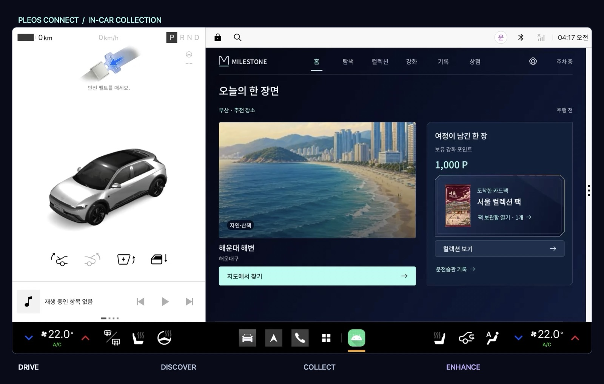

<sub>Pleos Connect 2.1.0 emulator · Android Automotive · 개발 화면의 working title은 MILESTONE</sub>

</div>

<br>

## Overview

어디를 다녀왔는지는 기억해도, 그곳까지 달린 시간은 쉽게 잊힙니다. **차곡차곡**은 그 이동을 포인트와 카드로 남깁니다.

주행 거리와 운전 기록으로 포인트를 얻고, 목적지에 방문하면 지역 카드팩을 수집합니다. 카드팩을 열어 새로운 카드를 만나고, 모은 포인트로 좋아하는 카드를 강화합니다. 달리는 동안에는 주행 정보만 보여주고, 수집과 강화는 차를 세운 뒤에 진행합니다.

`DRIVE` 주행 기록 → `DISCOVER` 장소 방문 → `COLLECT` 카드 수집 → `ENHANCE` 카드 강화


<a id="features"></a>

## Features

### 01 — Drive. 달린 거리만큼 쌓이는 포인트

목적지를 설정하면 기본 내비게이션과 연결되고, 주행이 끝나면 거리와 운전 기록을 바탕으로 포인트를 정산합니다. 장소 방문 여부와 관계없이 일상의 주행도 카드 성장에 쓰입니다.

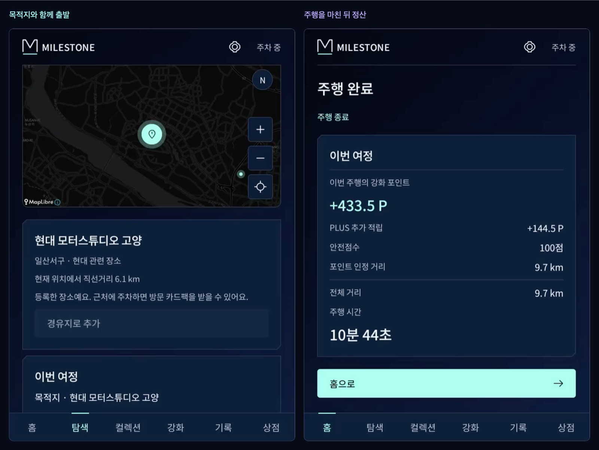

### 02 — Discover & Collect. 다녀온 곳에서 얻는 한 장

목적지나 경유지에 도착해 주차하면 방문 보상을 받을 수 있습니다. 지역별 카드팩에는 서울·부산·제주·현대 테마의 **45종 기본 도안**이 담겨 있습니다. 개봉은 봉투를 열고 카드를 뒤집는 두 단계로 진행됩니다.

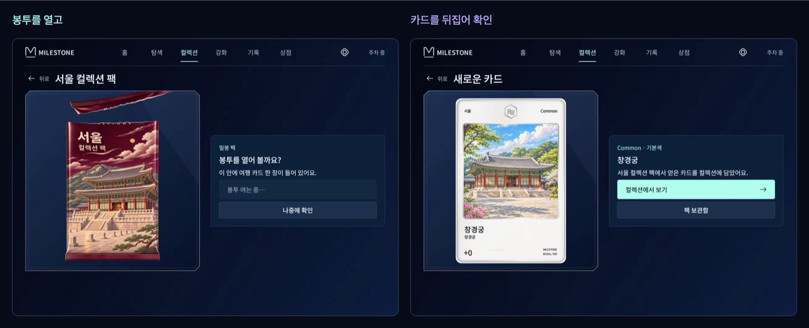

### 03 — Enhance. 모은 카드에 쌓이는 변화

주행 포인트로 카드를 강화합니다. **+5·+10·+15·+20·+25에서** 프레임과 재질이 달라지고, **+15부터** 원화가 카드 전체로 확장됩니다. 포일과 프리즘 효과는 카드 기울기에 따라 반응합니다.

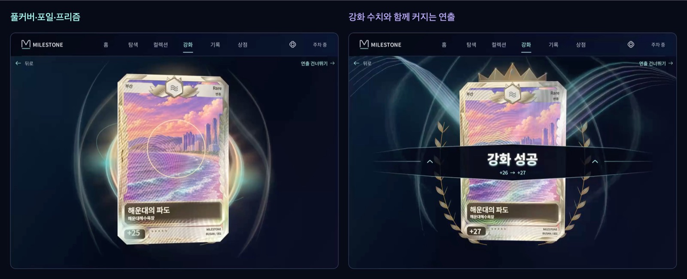

컬렉션에서 카드를 고르고, 강화한 뒤 다시 해당 카드로 돌아오는 흐름까지 연결했습니다. 강화 중 앱을 종료하더라도 확정된 결과와 카드 상태는 보존됩니다.

<details>
<summary>Collection & Forge 화면 보기</summary>

<br>

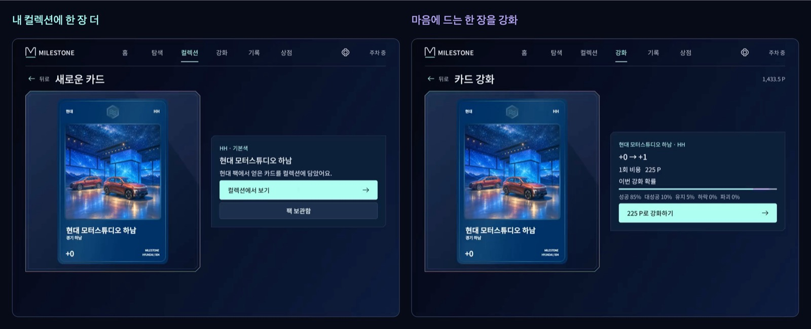

</details>

### 04 — PLUS. 주행 보상 확장

PLUS 이용 기간에는 주행 포인트가 최대 **1.5배** 적립됩니다. 구독 상태와 남은 이용 기간은 정산에 반영됩니다. **결제와 해지는 데모용 모의 처리**이며, 실제 결제 시스템과 연동되어 있지 않습니다.

<details>
<summary>PLUS 화면 보기</summary>

<br>

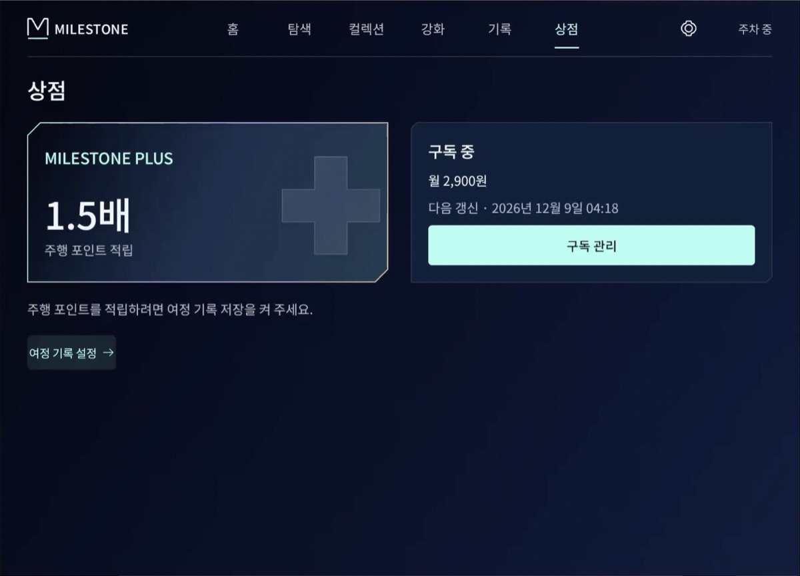

</details>


<a id="in-car-experience"></a>

## In-car experience

차량에서의 사용은 휴대전화와 다릅니다. **주행 중에는 기록을 확인하고, 정차 후에 조작하는 구조**를 기본으로 설계했습니다.

| Driving | Parked |
| :---: | :---: |
| 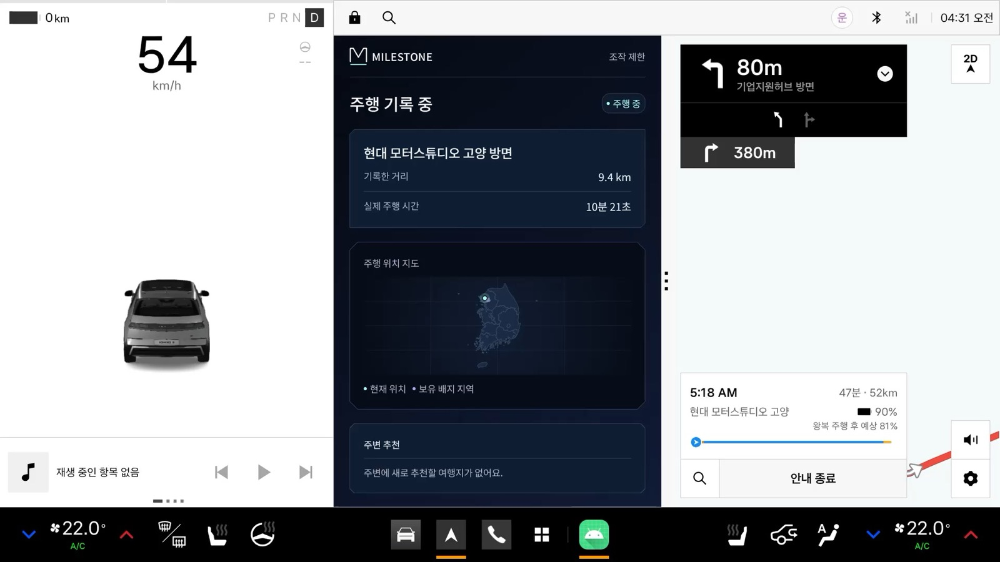 | 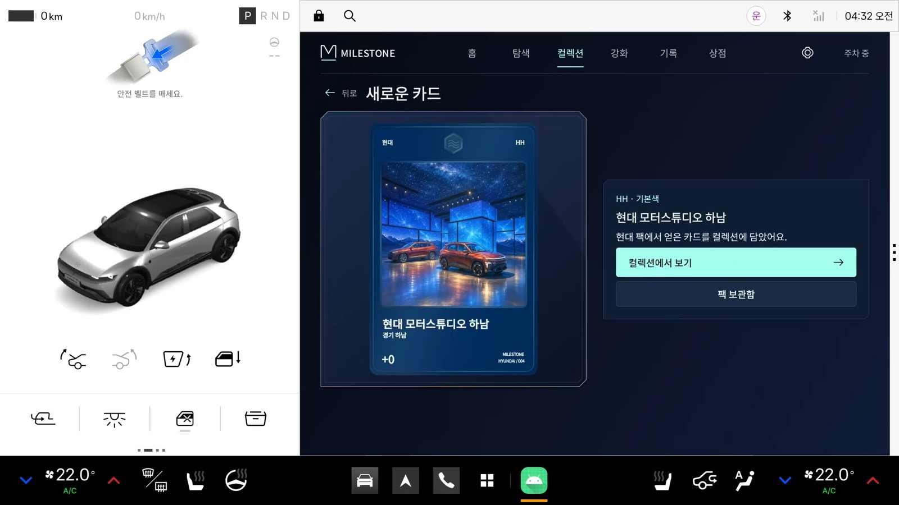 |
| 주행 정보 표시 · 수집/강화 조작 제한 | 장소 탐색 · 보상 수령 · 팩 개봉 · 카드 강화 |

차량의 속도·기어와 **Car UX Restrictions**를 함께 확인합니다. 차량 상태가 불분명하거나 플랫폼에서 조작을 제한하면 기능을 열지 않습니다. 화면에서 버튼을 노출할 때뿐 아니라 **사용자가 액션을 실행하는 시점에도 상태를 다시 검사**합니다.

### Platform integration

| API / SDK | Integration |
| --- | --- |
| **Android Automotive Car API** | Speed & gear signals · 주행 감지, 거리 분석, 주차 상태 판단 |
| **Car UX Restrictions** | 운행 상황에 따른 상호작용 제한 |
| **Pleos FusedLocation `1.1.3`** | 위치 업데이트 · 방문 범위 검증 |
| **Pleos NaviHelper `3.0.5`** | 목적지/경유지 등록 · 경로/도착 이벤트 구독 |

내비게이션 API 호출이 반환됐다는 이유만으로 목적지 등록을 성공 처리하지 않습니다. **경로 및 목적지 상태를 재조회해 실제 반영을 확인**하며, 실패·시간 초과·확인 중 상태를 구분합니다.

> **Validation scope** — Pleos Connect **2.1.0 에뮬레이터**에서 동작을 확인했습니다. 실차 검증은 진행하지 않았습니다.


<a id="engineering"></a>

## Engineering

### Architecture

**Kotlin + Jetpack Compose**, 18개 모듈을 기능과 책임 중심으로 분리했습니다. `feature`는 화면과 상태를, `core:domain`은 정책과 Repository contract를, `core:data`와 `core:vehicle`은 저장소 및 플랫폼 연동을 담당합니다.


- **Unidirectional Data Flow** — UI event는 ViewModel을 거쳐 처리하고, 결과는 `Flow` / `StateFlow`로 Compose에 전달합니다.
- **Platform-independent domain** — 도메인 정책과 Repository contract를 Android에 의존하지 않는 Kotlin/JVM 모듈에 둡니다.
- **Feature ownership** — Collection, Forge, Records 등 기능별로 화면과 ViewModel을 관리하며, 공통 카드 렌더링은 `core:card-ui`에서 공유합니다.
- **Dependency Injection** — Hilt로 구현체를 연결하고 `app` 모듈에서 화면 구성을 조립합니다.

<details>
<summary>Module layout</summary>

```text
app
├── navigation                 Feature registration & home composition
└── driving                    Foreground service

feature
├── main / nav                 Tabs, back stacks & navigation host
├── home                       Driving lifecycle
├── explore                    Map, place search, route requests
├── collection                 Packs, gallery & card details
├── forge                      Enhancement UI & motion
├── records                    History, scoring & points
├── membership                 PLUS shop & subscription state
└── settings                   Preferences

core
├── domain                     Models, policies & repository contracts
├── data                       Repository implementations
├── database                   Room, SQLCipher, migrations
├── vehicle                    Car API, FusedLocation, NaviHelper
├── card-ui                    Card rendering & animation
├── designsystem               Design tokens & shared components
├── navigation                 Routes & result contracts
└── ui                         Shared UI state & flow utilities

build-logic                       Gradle Convention Plugins
```

</details>

<a id="module-dependencies"></a>

### Module dependencies

이 그래프는 **18개 모듈의 코드 참조 44개**를 표시합니다. Kotlin에서 사용하는 타입·함수·리소스의 소유 모듈을 확인했으며, DI binding과 화면 factory 등록 전용 관계는 그림에서 제외했습니다. 전체 Gradle 선언 56개와 구분한 코드 참조도입니다.

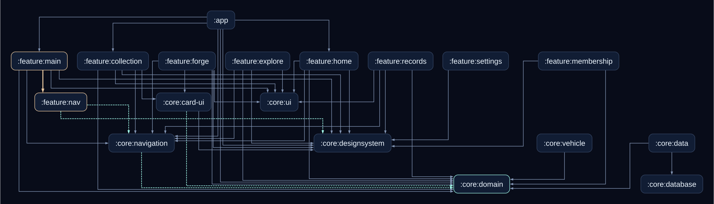

#### Feature references

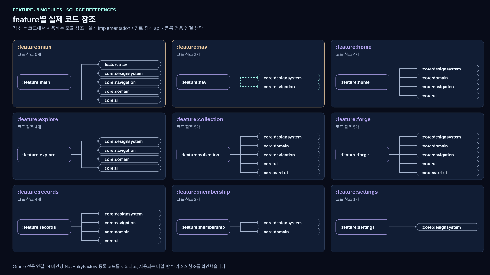


#### App references

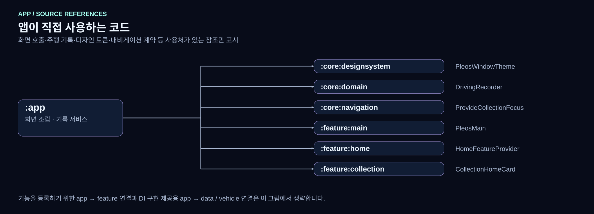

#### Core references

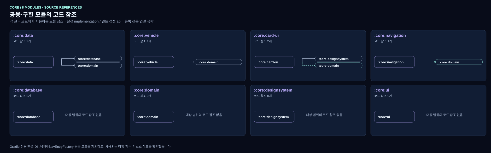


`feature:main`은 `feature:nav`의 `PleosNavDisplay`, `rememberPleosNavEntries`를 호출합니다. 나머지 기능은 Domain contract와 공통 UI 모듈을 통해 결합을 줄입니다. `build-logic:convention`은 included build의 Gradle plugin으로 적용됩니다.

#### UI state & effects

- Route/Destination이 Screen에 UI state와 Callback을 연결합니다.
- `collectAsStateWithLifecycle`을 통해 lifecycle-aware state collection을 수행합니다.
- 영속적인 카드·잔액·보상은 Database를 단일 진실 공급원으로 사용합니다.
- Navigation, permission request 같은 일회성 효과는 UI layer가 처리합니다.

### Implementation notes

| Topic | Approach |
| --- | --- |
| **Atomic persistence** | 방문 보상 지급, 팩 개봉, 강화 결과를 Room transaction으로 확정 |
| **Idempotency** | 정산 ID·`requestId`로 중복 적립/강화 요청을 방지 |
| **Optimistic concurrency** | 카드 `revision`과 데이터 `generation`으로 오래된 작업의 반영을 차단 |
| **Navigation consistency** | NaviHelper 요청 후 route/destination state를 다시 확인 |
| **Graphics pipeline** | Compose Canvas · Android Canvas · AGSL, OS 버전에 따른 fallback |
| **Render preparation** | 카드 뒷면 노출 중 이미지 로드 및 `ImageBitmap.prepareToDraw()` 선행 |

랜덤한 보상과 강화 결과는 **한 번 확정되면 재시도해도 바뀌지 않아야 합니다.** 그래서 화면 애니메이션과 영속 상태를 분리하고, 중간 종료·중복 요청·오래된 상태에서의 재시도를 독립적으로 처리했습니다.

<details>
<summary>Reward rules, persistence & rendering details</summary>

#### Vehicle state & UX restrictions

차량 속도·기어는 Android Automotive Car API로 구독하고, 플랫폼의 `Car UX Restrictions`와 함께 조작 가능 여부를 판단합니다. 위치와 기본 내비게이션 연결에는 Pleos FusedLocation `1.1.3`, NaviHelper `3.0.5`를 사용합니다.

- **Driving / restricted** — 주행 정보를 표시하되 탭 이동, 팩 개봉, 강화 조작을 제한합니다.
- **Parked / unrestricted** — P 기어, 정지, 유효한 차량 신호, 플랫폼 제한 해제가 확인되면 상호작용을 허용합니다.
- **Unknown / connecting** — 신호가 불명확한 경우 제한 해제를 보류합니다.

UI가 버튼을 표시할 때와 실제 동작을 수행할 때 상태를 각각 검사합니다. 내비게이션 분할 창과 넓은 앱 창에서 타이포 및 화면 배치를 조정합니다.

##### Navigation consistency

`NaviHelper`의 요청이 성공을 반환했다고 해서 내비게이션 상태가 실제로 변경되었다고 가정하지 않습니다. 목적지/경유지와 route를 다시 확인하고, 실패·시간 초과·확인 중 상태를 구분합니다. 홈과 탐색은 장소 세션을 공유하고, 마지막 구독자가 사라지면 SDK listener와 위치 callback을 해제합니다.

#### Transactional persistence

| Operation | Guarantee |
| --- | --- |
| Visit reward | 방문 수령 기록과 sealed pack을 하나의 DB transaction으로 저장 |
| Pack opening | 추첨 결과와 앞면 공개 여부를 분리해 중간 종료 후 복원 |
| Enhancement | 포인트 차감, 카드 변경, 최고 기록, 결과 영수증을 원자적으로 확정 |
| Retry | `requestId` 재요청에는 같은 결과를 반환 |
| Concurrency | 카드 `revision`으로 stale write 차단 |
| Mode switch / reset | DB 분리와 `generation` 검사로 이전 작업의 잘못된 반영 방지 |

결과 애니메이션은 영속 상태의 성공 여부를 결정하지 않습니다. 결과가 먼저 확정되며, 화면을 다시 열어도 같은 결과를 재구성합니다.

#### Driving analytics

기록된 speed sample의 timestamp를 사용해 거리를 적분하고 가속도 변화를 분석합니다.

| Metric | Rule |
| --- | --- |
| Rapid acceleration | `2.5 m/s²` 이상 `0.6 s` 유지 |
| Rapid deceleration | `3.0 m/s²` 이상 `0.6 s` 유지 |
| Event release | `0.8 s` 조건으로 중복 집계 감소 |
| Safety score | `round(100 − 60 × 급가속 횟수 / max(5, 이동 시간[분]))`, 0–100 제한 |

급제동 횟수는 기록하지만 현재 안전 점수에는 반영하지 않습니다. 신호 품질이 충분하지 않은 여정은 기록을 보관하되 안전 점수 및 포인트를 산출하지 않습니다.

##### Reward settlement

실제 거리 `2 km` 이상이면서 분석이 완료된 여정에 적용합니다. 주간 인정 주행 거리는 한국 시간 월요일 시작 기준 최대 `1,000 km`입니다.

```text
Eligible distance = min(driven distance, remaining weekly allowance)
Base points = floor(eligible distance [km] × 20P × (safety score / 100 × 1.5))
PLUS extra points = floor(base points × subscribed distance / total distance) / 2
```

예: `25 km`, 안전 점수 `80`인 경우 일반 `600P`, 전 구간 PLUS 사용 시 `900P`. 포인트는 `0.5P`를 표현할 수 있는 정수 단위로 저장하며 settlement ID로 중복 적립을 막습니다. 주 경계를 넘는 여정은 주별 거리 분할 자료가 없어 기록만 보관합니다.

#### Visit rewards & card upgrades

##### Visit packs

- 등록된 목적지 또는 경유지의 인정 범위에 도착하고 주차해야 보상을 수령할 수 있습니다.
- 하루 최대 `10회`, 같은 지역은 `14일`의 재수령 간격을 적용합니다.
- 일반 지역팩은 `Common` / `Rare` / `Epic`, 현대 팩은 `H` / `HH` 등급을 사용합니다.
- 일반 지역팩의 색상 변종 확률은 `5%`, 현대 팩은 `0%`입니다.

##### Enhancement rules

```text
Cost = (100 + 10 × current level) P × rarity multiplier

Common      ×1.00
Rare / H    ×1.50
Epic / HH   ×2.25
```

현재 평가용 확률 설정에서는 유지·파괴가 `0%`이며, +20부터 성공 `70%` / 하락 `30%`를 사용합니다. +0–19의 대성공은 +2로 처리합니다. 표시 확률과 결과 추첨은 동일한 `CardRules`를 사용합니다.

#### Card rendering pipeline

카드 재질 및 효과는 Compose Canvas, Android Canvas, AGSL로 구현합니다. Android 13 이상에서는 AGSL 반사를 사용하며, 하위 버전에는 Canvas fallback을 제공합니다.

- 강화 단계에 따라 frame, foil, prism, full-cover artwork를 다르게 표현합니다.
- 카드 크기·기울기·반사 상태를 화면 전환과 결과 연출 사이에서 이어갑니다.
- 카드 뒷면이 노출된 동안 `Dispatchers.IO`에서 원화와 프레임을 로드하고, `ImageBitmap.prepareToDraw()`로 그리기를 준비합니다.
- 첫 프레임에 레이아웃/재질 초기 작업이 몰리지 않도록 사전 준비하며, 접근성 정보는 실제 카드 공개 시점에 맞춰 노출합니다.


</details>

### Tech stack

| Category | Technologies |
| --- | --- |
| **Language** | Kotlin `2.2.10` |
| **UI** | Jetpack Compose · Material 3 · Custom Design System |
| **Architecture** | MVVM · UDF · Multi-module · Repository Pattern |
| **DI** | Hilt `2.59.2` |
| **Concurrency** | Kotlin Coroutines `1.10.2` · Flow · StateFlow |
| **Navigation** | Navigation 3 `1.2.0` |
| **Persistence** | Room `2.8.4` · SQLCipher `4.14.1` · Android Keystore |
| **Automotive** | Android Car API · Car UX Restrictions · Pleos SDK |
| **Map & Graphics** | MapLibre `13.7.1` · Compose Canvas · AGSL |
| **Build & Quality** | AGP `9.4.1` · Gradle `9.6.0` · Convention Plugins · JUnit · Compose UI Test · Lint · Spotless / ktlint · GitHub Actions |


<a id="demo"></a>

## Demo

| Video | Contents |
| --- | --- |
| [Full walkthrough · 1:54](docs/demo/01-journey-pack-to-forge.mp4) | 카드팩 → 목적지 설정 → 주행 정산 → 수집 → 강화 |
| [Enhancement milestones · 1:19](docs/demo/02-forge-milestones.mp4) | 강화 단계에 따른 프레임·풀커버·포일 변화 |
| [Enhancement outcomes · 0:58](docs/demo/03-forge-outcomes.mp4) | 성공·대성공·유지·하락·파괴 연출 미리보기 |

결과별 연출 영상에는 현재 설정상 발생 확률이 0%인 **유지·파괴**의 미리보기가 포함되어 있습니다.


<a id="build--run"></a>

## Build & run

**Requirements**

- Android Studio — AGP `9.4.1` 지원 버전
- JDK `25` (프로젝트 CI 기준)
- Android SDK Platform `37.0` (`minSdk 28` / `compileSdk 37` / `targetSdk 37`)
- Pleos Connect emulator `2.1.0` — 검증 환경: Android Automotive / Android 14, API 34, ARM64

```bash
git clone https://github.com/Pleos-Safe/Android.git
cd Android
./gradlew :app:assembleDebug

# 설치 대상은 adb devices 결과로 확인
adb devices
adb -s emulator-5554 install -r app/build/outputs/apk/debug/app-debug.apk
```

1. Pleos Connect 에뮬레이터를 실행한 뒤 빌드한 APK를 설치합니다.
2. 차량 홈의 앱 라이브러리에서 **PleosAndroid**를 실행하고, 속도 정보 및 정확한 위치 권한을 허용합니다.
3. **P 기어·정지 상태**에서 장소 탐색과 카드 수집을 이용합니다.
4. 빠른 체험은 **컬렉션 → 체험 모드**, 실제 주행 기록은 **기록 → 저장 설정**에서 활성화합니다.

`local.properties`에는 로컬 Android SDK 경로를 설정합니다. 위치 및 내비게이션 연동은 실행 환경의 서비스 연결과 인터넷이 필요합니다.

### Test environment & APK

| Environment | Verified configuration |
| --- | --- |
| Pleos Connect emulator | `2.1.0` |
| OS / ABI | Android Automotive · Android 14 / API 34 · ARM64-v8a |
| Display | `2560 × 1440px` · `160dpi` |
| Window | 차량 시스템과 앱 영역 · 내비게이션과 앱의 분할 창 |

**서명된 제출용 Release APK는 아직 등록 전입니다.** 아래는 팀명 확정 후 사용할 예정 경로입니다.

```text
apk/<팀명>_차곡차곡_release.apk
```

### Tests & checks

```bash
./gradlew testDebugUnitTest :core:domain:test --continue
./gradlew spotlessCheck
./gradlew lintDebug lintRelease --continue
./gradlew :build-logic:convention:check
```


<sub>Developed for the Hyundai Motor Group Pleos Connect vehicle app development competition.</sub>
