# 차곡차곡 브랜드 및 사용자 흐름 검증

2026년 11월 13일 · Pleos 가로형 에뮬레이터 · 차곡차곡 브랜드 적용본

차량 권한 설정부터 목적지·경유지 연동, 방문팩 수령·개봉, 주행 정산, 카드 강화와 재실행 후 저장 상태까지 확인했다. 이 문서는 앱 화면을 직접 조작한 결과와 별도 자동 테스트의 결과를 구분해 기록한다.

## 검증 방법과 범위

| 구분 | 실행 방법 | 결과의 의미 |
| --- | --- | --- |
| 실제 앱 흐름 | 별도 Android 사용자 11의 일반 앱을 조작하고 기어·속도·GPS를 에뮬레이터에 입력 | 화면 입력과 제품의 저장·정산·추첨 로직을 통과한 결과 |
| 분리된 DB 통합 테스트 | 메모리 Room DB, 합성 속도 표본, 명시적으로 고정한 추첨과 강화 결과 | 동일 방문팩·주행 정산·강화 요청의 재처리, 포인트 차감과 카드 저장 검증 |
| UI 캡처 테스트 | 실제 Compose 화면에 정해진 카드·강화 단계·결과를 전달 | 여러 단계와 결과 화면의 표시 검증 |

아래 대표 PNG 12장은 실제 앱의 화면 원본을 그대로 복사했다. GIF 두 개는 실제 부산 팩 개봉과 강화 녹화에서 만든 재생 자료다. 이 앱 흐름에서는 체험 모드나 결과 고정 픽스처를 사용하지 않았고, 카드 추첨·강화 확률을 바꾸거나 재추첨하지 않았다. 전국 간 이동은 GPS 위치 변경과 차량 신호 입력으로 재현했다.

전수 촬영 PNG 128장과 원본 녹화·검증 JSON은 별도 로컬 검증 아카이브에 보관했다. 저장소에는 검토용 PNG 12장 약 8.0MiB와 GIF 두 개 약 6.6MiB를 포함한다.

## 출발 전 목적지 설정

신규 프로필은 1,000P, 미개봉 서울 선물팩 한 개, 카드와 주행 기록 0개로 시작했다. 전용 온보딩 화면은 현재 구현돼 있지 않다. 첫 차량 권한과 홈, 기록 OFF에서 ON으로 변경하는 설정, 알림과 장소 위치 권한을 순서대로 확인했다.

경복궁을 출발 전에 목적지로 설정한 뒤 주행을 시작했다. 차량이 달릴 때 기록이 시작되고 D단 정차 중에는 제한 화면이 유지됐다. 경복궁에서 P단으로 바꾸고 방문팩을 받은 뒤 주행을 종료했다. 종료 확인창에서 취소하면 주차 중 여정이 유지되는 것도 확인했다.

| 최초 실행 | 경복궁 목적지 반영 |
| --- | --- |
| 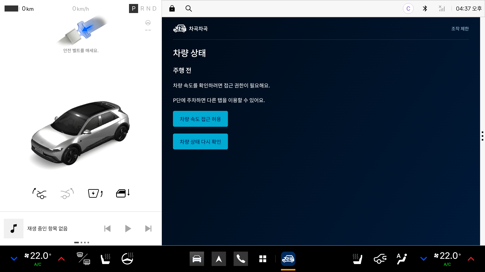 | 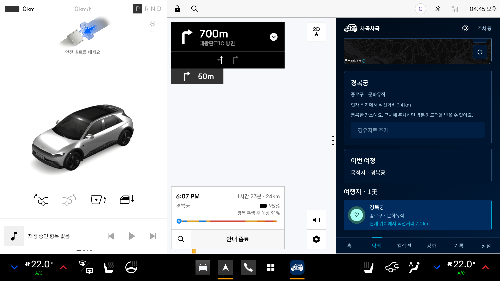 |
| 주차 후 서울 방문팩 수령 | 여정 A 종료 후 221P 적립 |
| 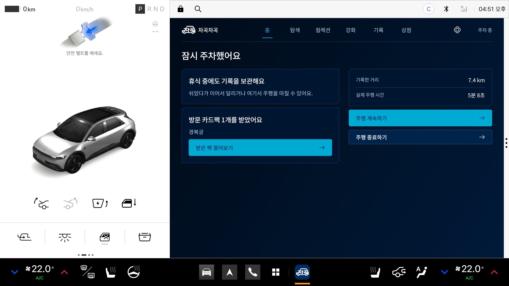 | 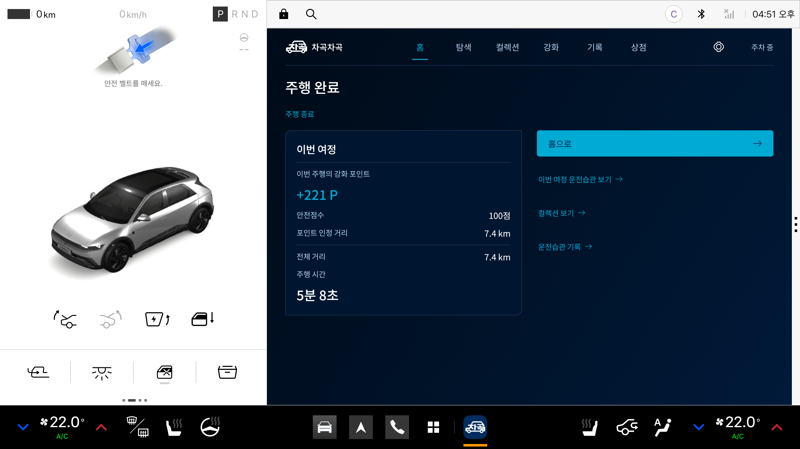 |

## 주행 중 추천 목적지와 두 경유지

목적지 없이 부산에서 출발해 추천 카드로 해운대를 목적지로 설정하고 광안리·이기대를 경유지로 추가했다. 기본 내비의 목적지와 두 경유지를 확인했고, 경유지가 두 곳인 상태에서는 추가 제한을 확인했다.

광안리에서 부산 방문팩을 받은 뒤 같은 여정을 계속했다. 같은 부산 지역인 이기대에서는 14일 대기 안내로 두 번째 부산팩 수령이 거절됐다. 여정을 종료하지 않고 현대 모터스튜디오 고양과 협재해수욕장으로 이동해 경기·제주 방문팩을 받았다. B·C·D 구간은 마지막에 한 번만 종료해 주행 기록 한 건으로 정산했다.

| 두 경유지와 추가 제한 | 같은 부산 지역의 14일 제한 |
| --- | --- |
| 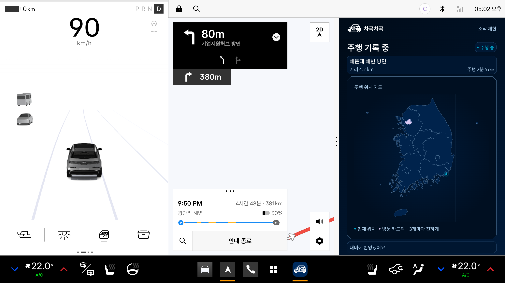 | 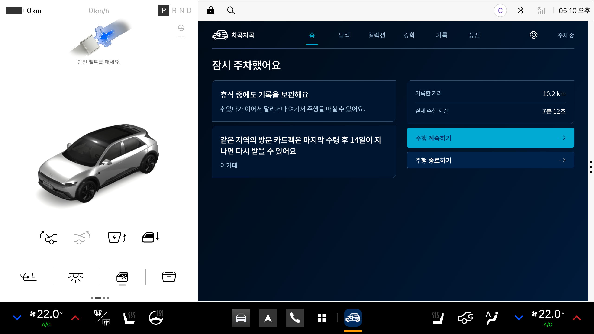 |
| 서울·부산·경기·제주 방문팩 지도 | B·C·D를 한 여정으로 정산한 651P |
| 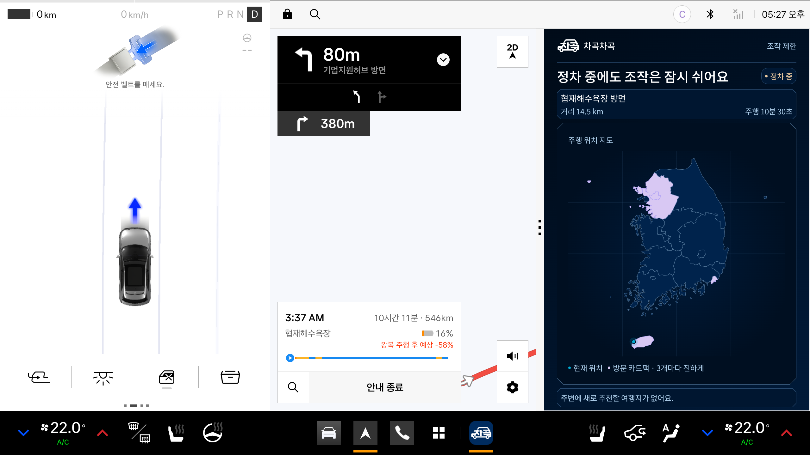 |  |

지도는 방문팩 수령 시점에 실제 방문 지역을 색칠했다. 이번 실제 앱 실행에서는 네 지역에 한 팩씩 받아 모두 1단계 농도였다. 개봉 카드의 장소가 고양과 다른 대전 E-pit이어도 지도는 방문 장소인 경기로 집계됐다. 3개 단위 여섯 농도 전체는 별도 팔레트·캡처 테스트로 확인한다. [지역 집계 테스트](../../core/data/src/androidTest/kotlin/io/issac/pleosandroid/core/data/collection/RegionVisitPackSourceTest.kt) · [농도 경계 테스트](../../feature/home/src/test/kotlin/io/issac/pleosandroid/feature/home/driving/VisitPackMapPaletteTest.kt)

## 실제 포인트와 카드 결과

| 여정 | 주행 거리 | 주행 시간 | 안전점수 | 일반 적립 | PLUS 추가 | 합계 |
| --- | --- | --- | --- | --- | --- | --- |
| A · 경복궁 | 7,386m | 5분 8초 | 100점 | 221P | 0P | 221P |
| B·C·D · 부산→고양→협재 | 14,471m | 10분 30초 | 100점 | 434P | 217P | 651P |
| E · 2km 미만 | 화면 표시 1.8km | 1분 25초 | 100점 | 0P | 0P | 0P |

E는 안전점수가 100점이어도 주행거리가 2km 미만이어서 0P로 정산됐고 주행 기록은 저장됐다. 주간 화면은 총 적립 872P, 전체 기록 거리 23.668km, 포인트 인정 거리 21.857km를 표시했다. PLUS 시작·갱신 해지 예약·갱신 재개와 재실행 후 구독 상태를 확인했다. PLUS는 실제 청구가 없는 모의 결제다.

| 방문 장소 | 수령 팩 | 실제 개봉 카드 | 실제 강화 |
| --- | --- | --- | --- |
| 경복궁 | 서울 | 낙산 Common 기본색 +0 | 100P 사용, 성공 +1 |
| 광안리 해변 | 부산 | 북항의 부캉이 Rare 기본색 +0 | 150P 사용, 대성공 +2 |
| 현대 모터스튜디오 고양 | 현대 | 대전 국립중앙과학관 E-pit H 기본색 +0 | 미시도 |
| 협재해수욕장 | 제주 | 애월 Common 기본색 +0 | 미시도 |

실제 부캉이 개봉과 강화 대성공은 아래 GIF로 확인할 수 있다. 현재 +0 강화는 성공 90%, 대성공 10%여서 실제 두 번의 강화에서는 실패가 나오지 않았다. 다른 강화 단계와 하락·잔액 부족·기존 흔적 복구 화면은 별도 UI 픽스처에서 확인했다.

| 부산 방문팩에서 부캉이 개봉 | 부캉이 강화 대성공 +0→+2 |
| --- | --- |
| 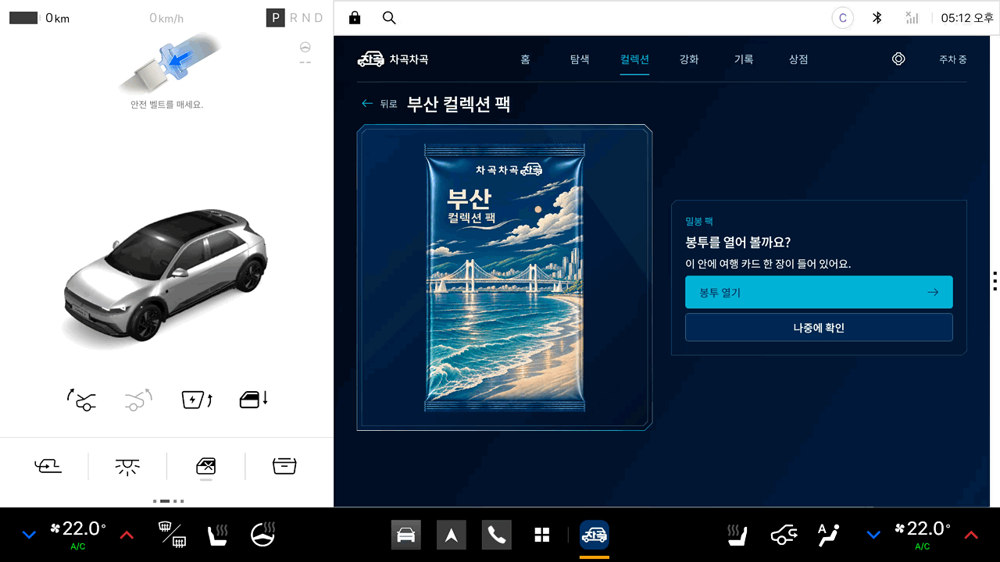 | 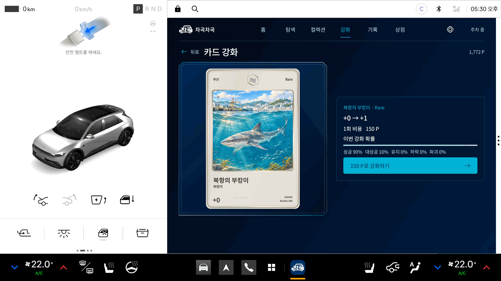 |

## 재실행과 기존 사용자 보존

앱을 종료하고 다시 실행한 뒤 1,622P, 주행 기록 3건, 방문 장소 4곳, 보유 카드 4장, 미개봉 서울 선물팩 한 개, 대표 카드 부캉이 +2, 모의 PLUS 활성 상태와 기록 ON 설정을 확인했다.

```text
초기 1,000P + 여정 A 221P + 여정 B·C·D 651P − 낙산 강화 100P − 부캉이 강화 150P = 1,622P
```

| 2km 미만 주행의 0P 정산 | 재실행 후 홈과 1,622P |
| --- | --- |
|  | 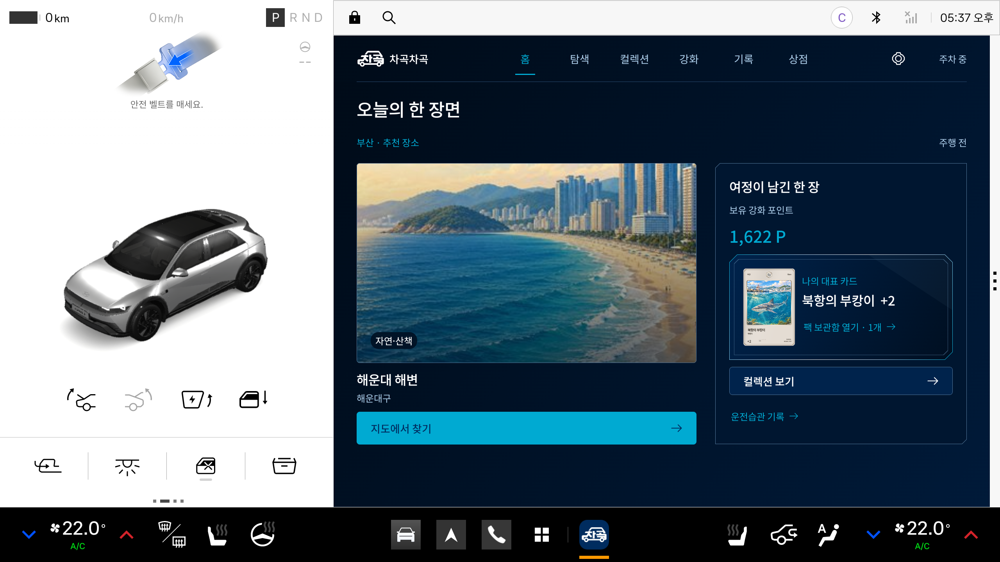 |
| 재실행 후 주행 기록 3건 | 재실행 후 실제 획득 카드 4장 |
| 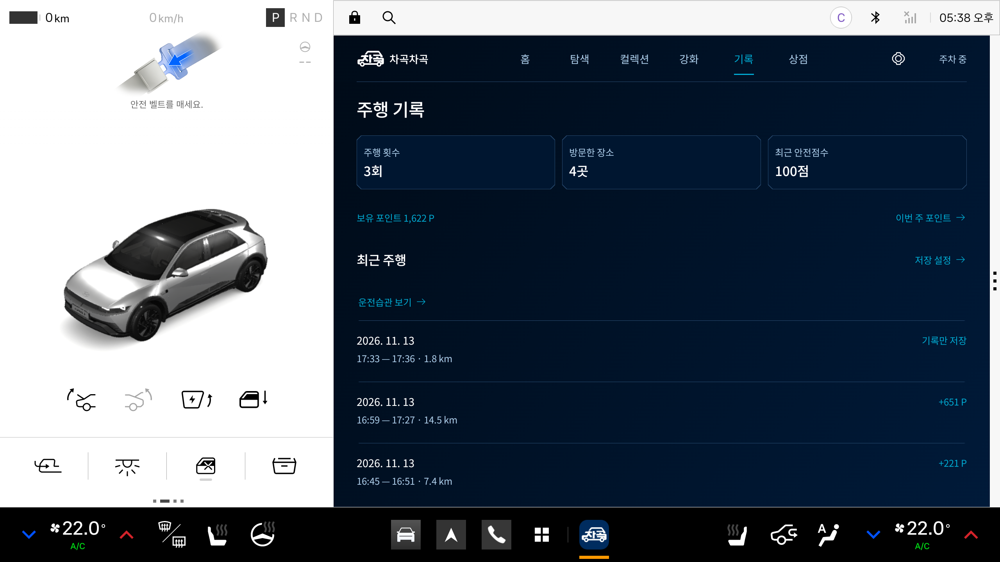 | 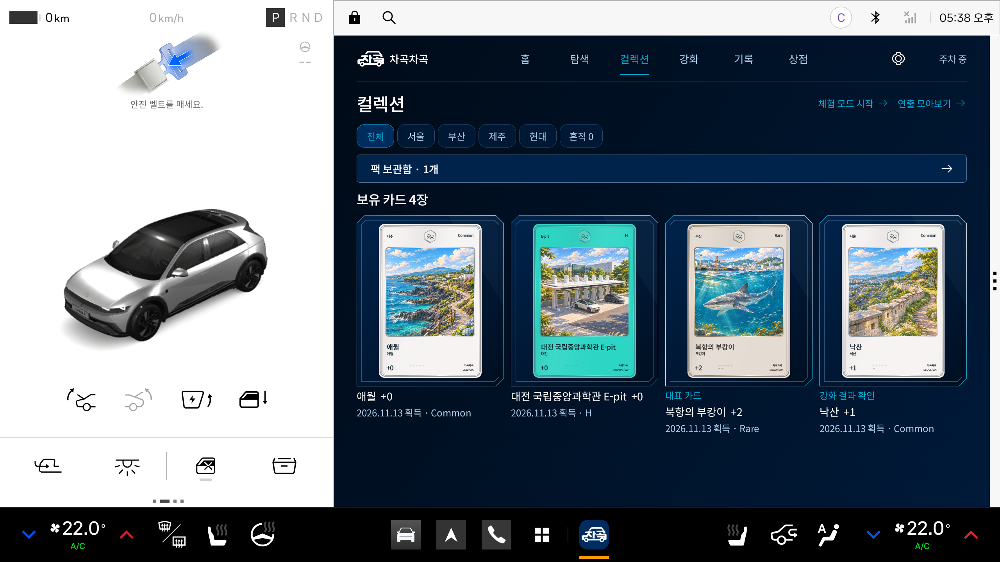 |

테스트 전후 기존 Android 사용자 10의 1,599P와 주행 기록 10건, 구독 비활성 상태를 확인했다. 사용자 복귀 후 OEM 작업면이 흰색으로 남아 일반 에뮬레이터 재부팅으로 화면을 복구했다. 데이터 초기화나 스냅샷 복원은 수행하지 않았다. 마지막 상태는 기존 사용자, P단, 속도 0이며 주행 입력 작업은 종료했다.

## 자동 검증

현재 설정에 포함된 모듈의 JUnit XML을 합산하면 단위 테스트 144개이며 실패·오류·스킵은 0개다. 삭제된 `feature/badges`의 잔여 빌드 결과 8개는 합계에서 제외했다. 별도 계측 회귀 테스트 15개와 선택 실행 캡처 테스트 두 개도 통과했다. 앱·테스트 APK 빌드, Spotless와 변경 모듈의 Debug·Release Lint 결과는 성공이다.

| 검증 | 통과 | 확인한 동작과 소스 |
| --- | --- | --- |
| 도메인 단위 테스트 | 58 | [주행·방문·포인트·카드 정책](../../core/domain/src/test/kotlin/io/issac/pleosandroid/core/domain) |
| 나머지 현재 모듈 단위 테스트 | 86 | app 1, navigation 15, ui 6, vehicle 16, collection 4, explore 4, forge 7, home 27, main 1, nav 3, records 2 |
| 공통 컴포넌트 계측 | 9 | [헤더·입력·버튼·다이얼로그](../../core/designsystem/src/androidTest/kotlin/io/issac/pleosandroid/core/designsystem/component/PleosComponentsTest.kt) |
| 탭 계측 | 3 | [제한 상태 라우터·복원·화면 전환](../../feature/main/src/androidTest/kotlin/io/issac/pleosandroid/feature/main/MainTabsTest.kt) |
| 작은 주행 화면 계측 | 1 | [520dp·글자 배율 1.0/1.5·지도·추천·안전 안내](../../feature/home/src/androidTest/kotlin/io/issac/pleosandroid/feature/home/DrivingOverviewCaptureTest.kt) |
| 팩 벡터 계측 | 1 | [고밀도 720×1080 상한과 모서리·내부 불투명도](../../feature/collection/src/androidTest/kotlin/io/issac/pleosandroid/feature/collection/pack/PrintedPackTest.kt) |
| 부캉이 DB 통합 계측 | 1 | [방문팩·주행 정산·25회 강화·재처리·저장](../../core/data/src/androidTest/kotlin/io/issac/pleosandroid/core/data/cards/BukangiGrowthIntegrationTest.kt) |
| 컬렉션 선택 실행 캡처 | 1 | [팩·카드·컬렉션의 고정 UI 시나리오](../../feature/collection/src/androidTest/kotlin/io/issac/pleosandroid/feature/collection/CollectionFlowCaptureTest.kt) |
| 강화 선택 실행 캡처 | 1 | [강화 단계와 결과의 고정 UI 시나리오](../../feature/forge/src/androidTest/kotlin/io/issac/pleosandroid/feature/forge/ForgeFlowCaptureTest.kt) |

메모리 DB 통합 테스트는 합성 속도 표본으로 300km·100점 여정을 만들고 9,000P 적립과 25회 강화 8,250P 차감을 검증한다. 초기 1,000P를 포함한 최종 잔액은 1,750P다. 같은 카드의 +0→+25, 영수증과 포인트 원장, 중복 요청의 재지급·재차감 방지, 저장소를 다시 생성한 뒤 같은 상태를 확인한다. 이 수치와 +25 결과는 분리된 테스트 데이터이며 위 실제 앱의 1,622P·부캉이 +2와 별도다.

### 최소 재현 명령

저장소 루트에서 단위 테스트와 정적 검사를 실행한다. Pleos SDK를 사용할 수 있는 기존 프로젝트 개발 환경을 전제로 한다.

```sh
./gradlew test spotlessCheck
```

Android 기기 한 대를 연결하고 분리된 DB 통합 테스트를 실행한다.

```sh
./gradlew :core:data:connectedDebugAndroidTest \
  -Pandroid.testInstrumentationRunnerArguments.class=io.issac.pleosandroid.core.data.cards.BukangiGrowthIntegrationTest
```

UI 캡처는 기본적으로 선택 실행이다. 다음 명령은 고정 UI 시나리오를 1216dp·520dp로 촬영하고 테스트 앱의 `files/screenshots/collection-flow`, `files/screenshots/forge-flow`에 저장한다.

```sh
./gradlew :feature:collection:connectedDebugAndroidTest \
  -Pandroid.testInstrumentationRunnerArguments.class=io.issac.pleosandroid.feature.collection.CollectionFlowCaptureTest \
  -Pandroid.testInstrumentationRunnerArguments.captureCollectionFlow=true

./gradlew :feature:forge:connectedDebugAndroidTest \
  -Pandroid.testInstrumentationRunnerArguments.class=io.issac.pleosandroid.feature.forge.ForgeFlowCaptureTest \
  -Pandroid.testInstrumentationRunnerArguments.captureForgeFlow=true
```

전체 디스플레이 촬영에 사용하는 `captureFullscreenDisplay`와 `captureAdjacentDisplay`는 OEM 창 배치를 수동 확인하고 준비 파일을 전달하는 외부 제어가 필요하다. 위 최소 명령은 해당 옵션을 사용하지 않는다.

## 확인된 제약과 후속 검토

- 전용 온보딩 화면은 미구현이다. 현재 첫 설정은 권한 대화상자와 설정 화면을 이용한다.
- 내비 중앙·앱 오른쪽의 나란한 창과 주차 후 전체 창은 OEM 시스템에서 수동 조절했다. 자동 창 배치는 이번 결과에 포함되지 않는다.
- 기본 내비가 목적지·경유지 요청을 수락하고 안내했지만 도로 타일은 흰색이고, 기본 내비 위치는 앱의 주입 GPS와 달랐다. 실제 도로 안내 품질과 정확한 경로 추종은 추가 확인이 필요하다.
- 자연 주행에서 안전 안내 스낵바는 관찰하지 못했다. 안내별 화면은 고정 UI 계측으로 검증했다.
- 방문팩은 진행 중인 여정을 종료하기 전에 P단 주차 상태에서 받아야 한다. 신규 카드 상세에는 방문 장소 출처가 보이지만 직접 여정 링크는 표시되지 않는다.
- 하루 10곳·주간 1,000km 한도 전체를 이번 실제 앱 흐름에서 소진하지는 않았다. 실제 앱에서는 같은 지역 14일 제한과 2km 미만 0P를 확인했다. 한도 정책 경계는 관련 자동 테스트의 범위다.
